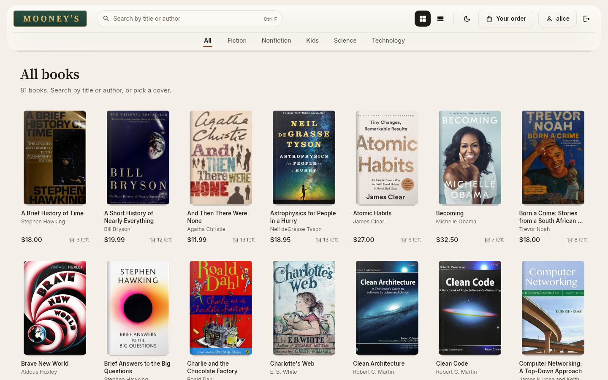
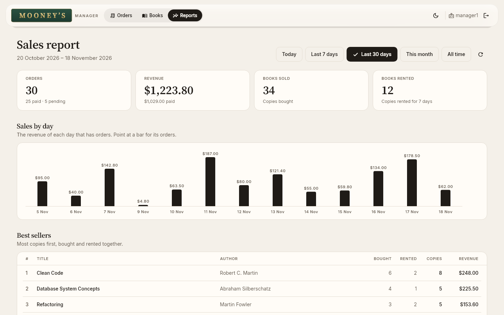
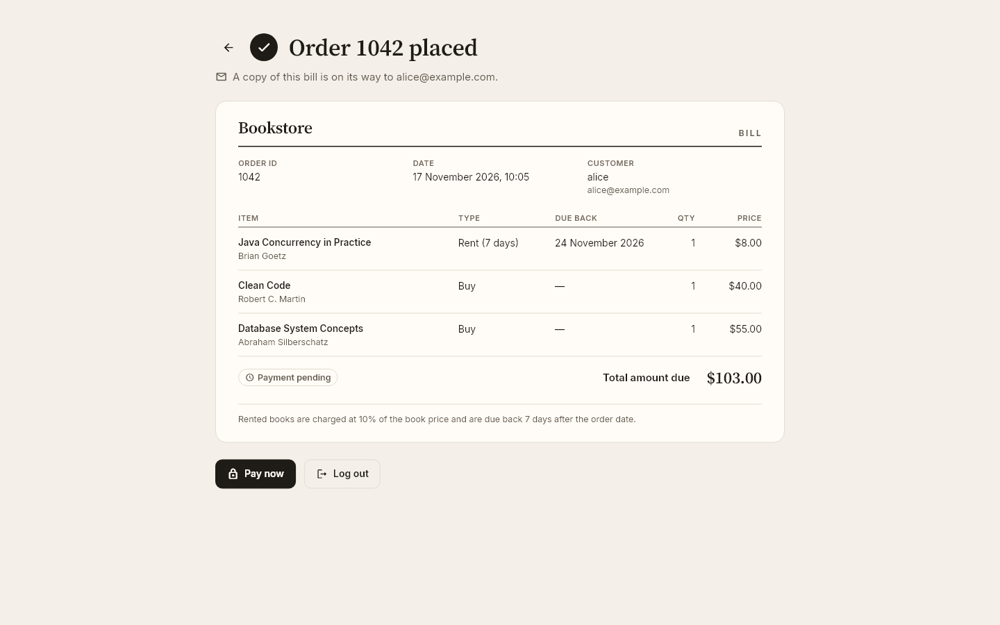
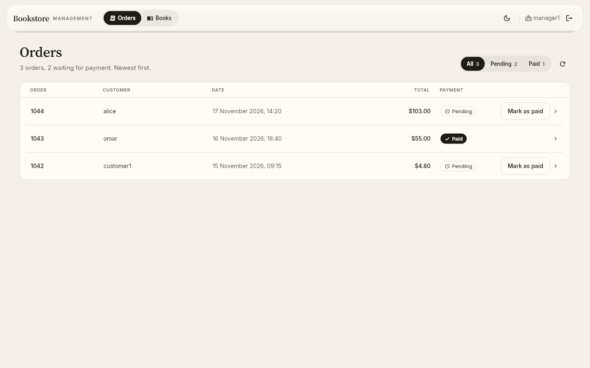
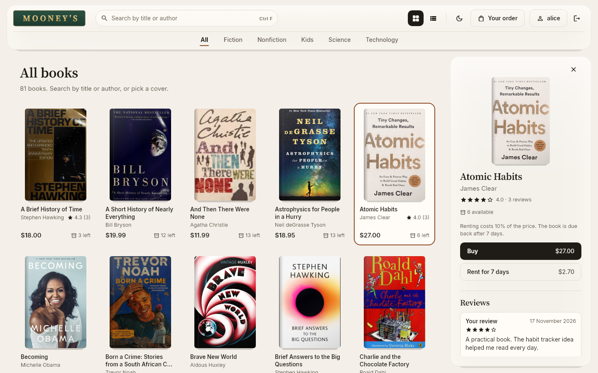
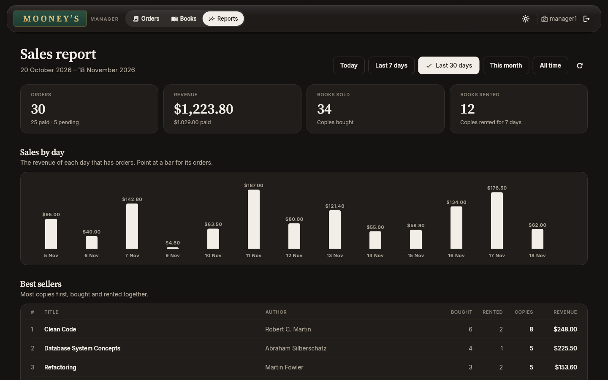
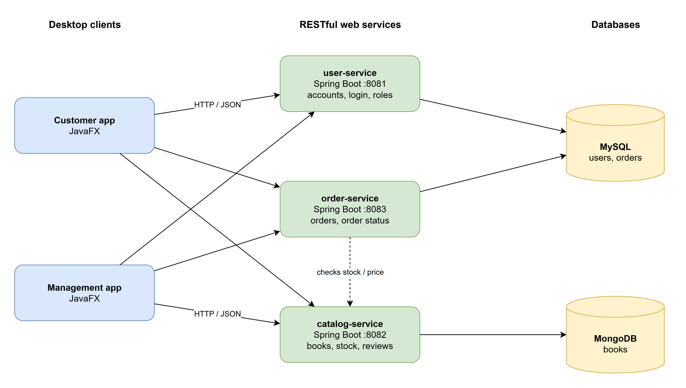

<h1 align="center">Mooney's: handover for the instructor</h1>

CSCE310 online bookstore. An individual project, due 2026-12-04. 
Everything needed to install, try, and grade it, and where the evidence for each part is.

<a href="https://github.com/KFUPMer/csce310-bookstore">Repository</a> ·
<a href="https://github.com/KFUPMer/csce310-bookstore/releases/latest">Latest release</a> ·
<a href="INSTALL.md">INSTALL.md</a> ·
<a href="docs/06-testing/requirements-test.md">Requirements test report</a> ·
<a href="docs/07-report/README.md">Course report</a>

<table>
  <tr>
    <td width="50%"></td>
    <td width="50%"></td>
  </tr>
  <tr>
    <td align="center"><b>Mooney's</b>, for customers: search, shelves, buy or rent</td>
    <td align="center"><b>Mooney's Manager</b>, for managers: orders, books, sales report</td>
  </tr>
</table>

## At a glance

| **What was built** | Three RESTful services and two Windows desktop apps (Flutter) |
|---|---|
| **Requirements** | All 14 functional (FR1 to FR14) and 5 non-functional (N1 to N5) met, each with evidence in the [test report](docs/06-testing/requirements-test.md) |
| **Extra credit** | Every item claimed: FR3, FR10, a modern GUI framework, and the three in section 6 of the course document ([below](#extra-credit-claimed)) |
| **Tests** | 333 automated tests, 41 live checks, all passing ([by part](#process)) |
| **Latest version** | [v1.2.0](https://github.com/KFUPMer/csce310-bookstore/releases/latest): 81 books, and demo customers with past sales and reviews |
| **Fresh-machine test** | v1.2.0, installed from the published release on a clean GitHub Windows machine by following INSTALL.md: setup, all 41 service checks, and both apps passed. (An earlier run stopped once when user-service did not start and could not be reproduced: [P-018](docs/03-problems/problem-log.md#p-018--user-service-once-did-not-start-in-the-fresh-machine-test-of-v120).) |

| Part | Built with | Does |
|---|---|---|
| **user-service** | Java HttpServer, MySQL | Accounts, login, sessions, roles |
| **book-service** | Python Flask, MongoDB | Search, books, reviews |
| **order-service** | Python Flask, MySQL | Orders, HTML bills, bill email, payment status, sales report |
| **Mooney's** | Flutter | The customers' app |
| **Mooney's Manager** | Flutter | The managers' app |

## Install in about 15 minutes

Windows 10 or 11, 64-bit. The full steps, and what to do if something goes wrong, are in [INSTALL.md](INSTALL.md).

1. Install **MySQL Server 8** if it is not there yet. It is the only thing installed by hand.
2. From the [latest release](https://github.com/KFUPMer/csce310-bookstore/releases/latest), download `Mooneys-Server-<version>.zip` and `Mooneys-Apps-Setup-<version>.exe`.
3. Unzip the server and double-click **`setup.cmd`**. It installs what is missing (Java 21, Python 3.12, MongoDB) and creates the data. It asks one thing: the MySQL root password, once, typed into MySQL itself.
4. Double-click **`start-services.cmd`**. Three minimized windows open, one per service.
5. Run the apps installer. It adds **Mooney's** and **Mooney's Manager** to the Start menu.

| Role | App | Username | Password |
|---|---|---|---|
| Customer | Mooney's | `customer1` | `customer123` |
| Demo customer, with past orders and reviews | Mooney's | any of the 14, e.g. `omar.aziz` | `demo12345` |
| Manager | Mooney's Manager | `manager1` | `manager123` |

`setup.cmd` also loads the demo data: 81 books, 14 invented customers, 100 past sales over the last 60 days, and their reviews, so the Reports tab and the star ratings have something to show from the start.

> [!WARNING]
> The installer is not code-signed, so Windows warns about an "unknown publisher": choose **More info**, then **Run anyway**. Where **Smart App Control** is on, Windows blocks it outright, as it does on the development computer. The way round is to build the apps from the source with `flutter run -d windows` ([INSTALL.md, "Building from the source instead"](INSTALL.md#building-from-the-source-instead)).

## A walk through every requirement

About five minutes, with the services running.

| # | Do this | Shows |
|---|---|---|
| 1 | Open **Mooney's**, click **Create an account**, and register a new customer | FR3 (extra credit), N3 |
| 2 | Log in as that customer | FR1, FR2 |
| 3 | Type "java" in the search, then switch to the list view. Click a shelf under the sign, e.g. Fiction | FR4, FR5 |
| 4 | Open a book and **Buy** it; open another and **Rent for 7 days** | FR6, FR7 |
| 5 | **Your order**, then **Place order**: the bill opens | FR7, FR8 |
| 6 | The bill is saved as `services\order-service\bills\bill-<id>.html`, and emailed if a Gmail app password is set (optional, [INSTALL.md](INSTALL.md#optional-email-the-bills)) | FR9, FR10 (extra credit) |
| 7 | Try to log in to **Mooney's Manager** with the customer account: it is refused | FR11, N5 |
| 8 | Log in to **Mooney's Manager** as `manager1`: every order is listed, newest first | FR11, FR12 |
| 9 | Click **Mark as paid** on the new order, then open it to see its bill and click **Print bill** | FR13, FR9 |
| 10 | **Books** tab: add a book, or change a book's copies, then search for it in Mooney's | FR14 |
| 11 | In **Mooney's**, open a book and write a review under **Reviews** in its detail panel (1 to 5 stars and a few words). It is listed first as "Your review", with Edit and Delete, and the book's card shows its stars | Reviews and ratings (extra credit) |
| 12 | In **Mooney's Manager**, open **Reports** and switch the period (Today, Last 7 days, Last 30 days, This month, All time): the tiles, the sales-by-day chart, the best sellers, and the orders change with it | Sales report (extra credit) |
| 13 | Every action answers at once, and the windows never freeze while waiting | N1, N2 |

N4 (a valid token on every request) and N5 (each role limited to its own data) are enforced by the services. The [test report](docs/06-testing/requirements-test.md#non-functional-requirements) lists the tests and live checks for each.

<b>What steps 5, 8, 11, and 12 look like</b> (screenshots drawn from the real app widgets)

 
<table>
  <tr>
    <td width="50%"></td>
    <td width="50%"></td>
  </tr>
  <tr>
    <td align="center">Step 5: the bill, with the rented book's due-back date</td>
    <td align="center">Step 8: every order, with Mark as paid</td>
  </tr>
  <tr>
    <td width="50%"></td>
    <td width="50%"></td>
  </tr>
  <tr>
    <td align="center">Step 11: a book's reviews, with "Your review" first</td>
    <td align="center">Step 12: the sales report for the last 30 days, in dark mode</td>
  </tr>
</table>

## The PRD's fixed choices

| PRD | This project |
|---|---|
| RESTful services | Three services, JSON over HTTP, one error shape `{ "error": "…" }` |
| Java HttpServer and Python Flask | user-service: Java 21 with the built-in `com.sun.net.httpserver`. book-service and order-service: Flask, served by waitress |
| MySQL and MongoDB | MySQL: users, sessions, orders, order items. MongoDB: books and their reviews |
| Two native desktop GUI apps | Flutter on Windows; no web pages |
| Bill as HTML, saved, printable | Saved per order; the manager app opens it in the browser to print |

## Extra credit claimed

| Item | Where |
|---|---|
| FR3: user registration (+1%) | `POST /api/users/register` in user-service; the **Create an account** screen in Mooney's |
| FR10: email the bill (+1%) | order-service sends the HTML bill through Gmail SMTP in the background. A real email was received and checked in Gmail ([P-016](docs/03-problems/problem-log.md#p-016--the-first-real-bill-email-arrived-with-its-layout-broken)) |
| Modern GUI framework (+2%) | Flutter, with one design system shared by both apps (`clients/bookstore-ui`) |
| Section 6: user profiles with order history (+1%) | The customer's **Your account** page, built in M4: profile, preferences, every order with its bill, rentals due back. `GET /api/orders/mine` in order-service |
| Section 6: book reviews and ratings (+1%) | book-service: `GET /api/books/{id}/reviews`, `PUT` and `DELETE /api/books/{id}/reviews/mine`, in the MongoDB collection `reviews`, one review per customer per book (a unique index). Each book's `ratingAverage` and `ratingCount` are worked out from the reviews on every search, never stored. Mooney's shows the stars and review count on every reviewed book, and a Reviews section in the detail panel. Any logged-in customer may review any book; a manager cannot |
| Section 6: sales report for managers (+1%) | order-service: `GET /api/reports/sales?from=&to=&top=` (managers only): orders, revenue, books sold and rented, sales by day, best sellers. Mooney's Manager: the **Reports** tab |

## Where to find the evidence

| You want | Look at |
|---|---|
| Each requirement and the evidence that it works | [docs/06-testing/requirements-test.md](docs/06-testing/requirements-test.md) |
| The course report: database, REST API with its JSON, screens, architecture (client/server, 3-tier, MVC) and classes; and the acceptance-test videos | [docs/07-report](docs/07-report/README.md) |
| The requirements as received, and the decisions about them | [docs/01-idea/project-idea.md](docs/01-idea/project-idea.md) |
| Architecture, and the reason for each decision | [docs/02-design/architecture.md](docs/02-design/architecture.md) |
| UML: use case, class (7: one per service and app, the shared package, and an overview), sequence (4), activity (3), state machine, component, object, profile, ER, plus the architecture diagram and wireframes. 23 diagrams, each a draw.io source with its image | [docs/02-design/uml-diagrams.md](docs/02-design/uml-diagrams.md), [class-diagrams.md](docs/02-design/class-diagrams.md) |
| Use case descriptions | [docs/02-design/use-cases.md](docs/02-design/use-cases.md) |
| Database design (MySQL and MongoDB) | [docs/02-design/database-design.md](docs/02-design/database-design.md), [database/](database/README.md) |
| Every endpoint: request, answer, and errors | [docs/02-design/api-design.md](docs/02-design/api-design.md) |
| The visual design and its accessibility (color-blind safe, Nielsen's 10 heuristics), with a screenshot of every screen | [docs/02-design/style-guide.md](docs/02-design/style-guide.md) |
| How the code is written (four layers in every service, one error shape) | [docs/02-design/engineering-rules.md](docs/02-design/engineering-rules.md) |
| What went wrong, who caused it, and how it was fixed | [docs/03-problems/problem-log.md](docs/03-problems/problem-log.md) |
| What was made better than required, with the measured effect | [docs/03-problems/enhancement-log.md](docs/03-problems/enhancement-log.md) |
| The plan, milestones, and dated progress notes | [docs/04-planning/milestones.md](docs/04-planning/milestones.md), and the repository's GitHub milestones, issues, and releases |
| Every version and what changed in it | [CHANGELOG.md](CHANGELOG.md) |
| Tools and versions on the development computer | [docs/05-setup/environment.md](docs/05-setup/environment.md) |
| Everything taken from outside, with its license; the use of an AI assistant | [REFERENCES.md](REFERENCES.md) |
| Each service's and app's own README (how to run, test, and read it) | [services/](services/README.md), [clients/](clients/README.md) |

<b>The architecture in one picture</b>

 

## Beyond the PRD

Asked for by the owner, and not needed for any grade:

- the store's name and sign, **Mooney's**;
- five **shelves** (Fiction, Nonfiction, Kids, Science, Technology) with real **cover photos** from Open Library;
- a **demonstration checkout** that marks an order as paid. It asks for no card details. The PRD's manager payment flow (FR13) is unchanged.

## Process

- **Six milestones**, each closed with a tagged GitHub release, most well before their deadlines: M1 Idea (v0.1.0), M2 Design (v0.2.0), M3 Backend (v0.3.0), M4 Clients (v0.4.0), M5 Testing and final release (two betas, the second installed from the published release on a fresh GitHub Windows machine, then v1.0.0), and M6, the section-6 extra credit (v1.1.0). Dated notes in [milestones.md](docs/04-planning/milestones.md).
- **Tasks as GitHub issues**, each closed with a note of what was done.
- **22 problem-log entries** (P-001 to P-022), including the assistant's own mistakes, and **51 enhancement-log entries** (E-001 to E-051), each with its reason and measured effect.
- **Tests with the code**: every service and app has its own tests, run again on GitHub before each release (the tests that need MySQL or MongoDB skip themselves there; they run on the development computer). order-service and the later app features were written test-first. A code review before committing found what the tests had not ([P-015](docs/03-problems/problem-log.md#p-015--order-service-passed-all-its-tests-with-faults-a-review-then-found)).

| Part | Automated tests |
|---|---|
| user-service | 26 |
| book-service | 71 |
| order-service | 117 |
| Shared package `bookstore-ui` | 40 |
| Mooney's (customer app) | 46 |
| Mooney's Manager | 33 |
| **Total** | **333**, plus 41 checks on the running services (`manual_check.py`) |

## Known limits

Listed so nothing is a surprise. The full list is under [Known gaps](docs/03-problems/problem-log.md#known-gaps) at the end of the problem log.

- **Windows only.** Both apps are built for Windows desktop.
- **The installer is not code-signed** (see the warning under Install).
- **No person has yet used the installed release apps** on a computer other than GitHub's test machine; Smart App Control blocks them on the development computer (P-017).
- **Returning a rented book is not built**; the PRD does not ask for it. A manager can raise a book's copies instead.
- **Sessions end only at logout**, which is what FR2 asks.
- **Reviews are open to any logged-in customer**, not only one who bought the book, and managers do not moderate them. Both decided on purpose (E-048).
- **`setup.cmd`'s winget installs** (Java, Python, MongoDB), and a person typing the MySQL root password, have not been tried on a real computer that lacked them. On GitHub's fresh machine the test did those steps itself; the rest of setup was proven there from nothing.
- **Not tested:** screen readers, a color-blindness simulation, trackpad scrolling, and the bill email in mail programs other than Gmail on the web.

## Use of an AI assistant

Much of the code, documentation, and diagrams was produced with Claude (Anthropic) as a coding assistant, directed by the project owner. The owner made every decision and approval: technology, visual style, scope. Those commits carry `Co-Authored-By: Claude`, and the assistant's mistakes are logged as such. Details in [REFERENCES.md](REFERENCES.md#6-use-of-an-ai-assistant).
