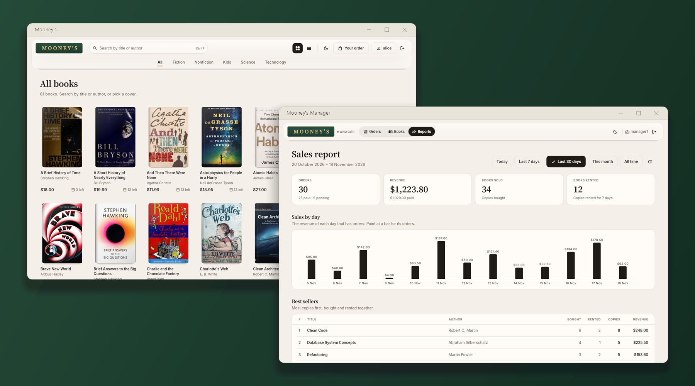
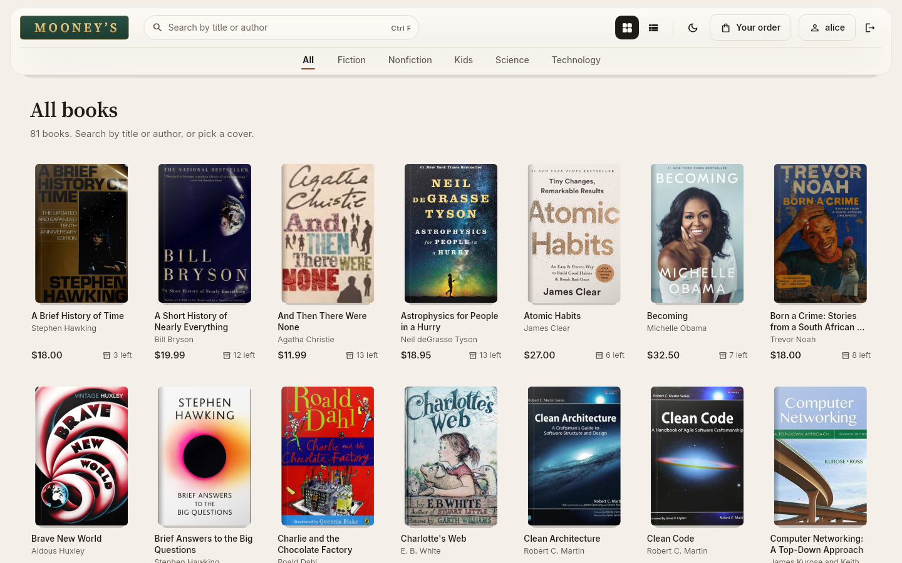
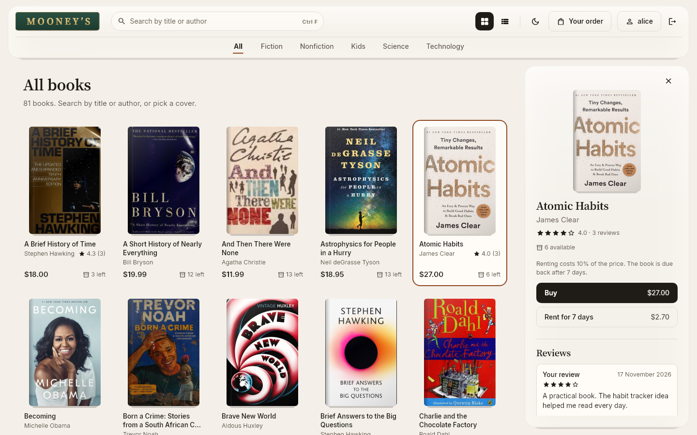
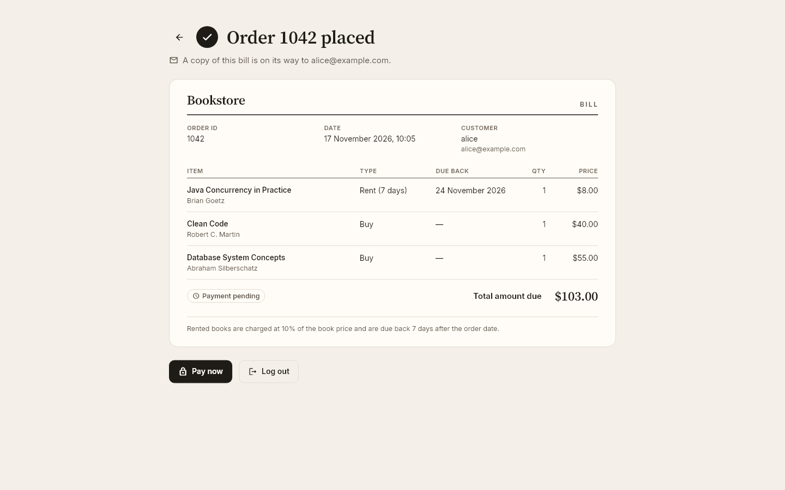
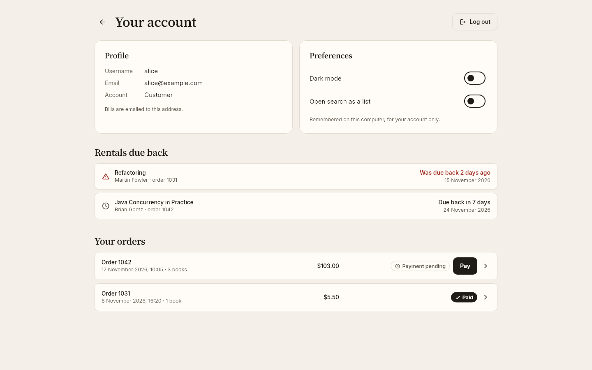
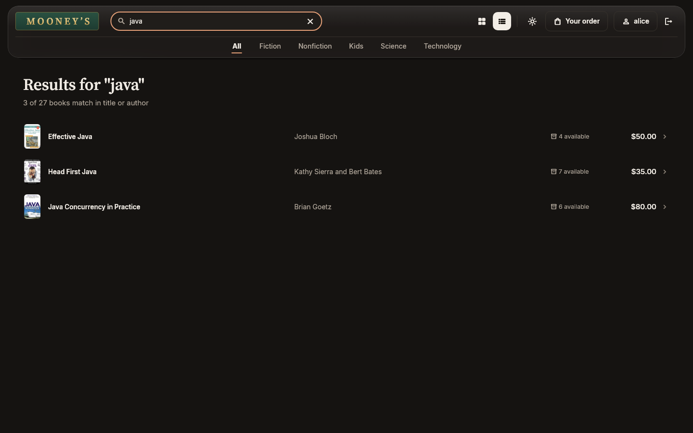
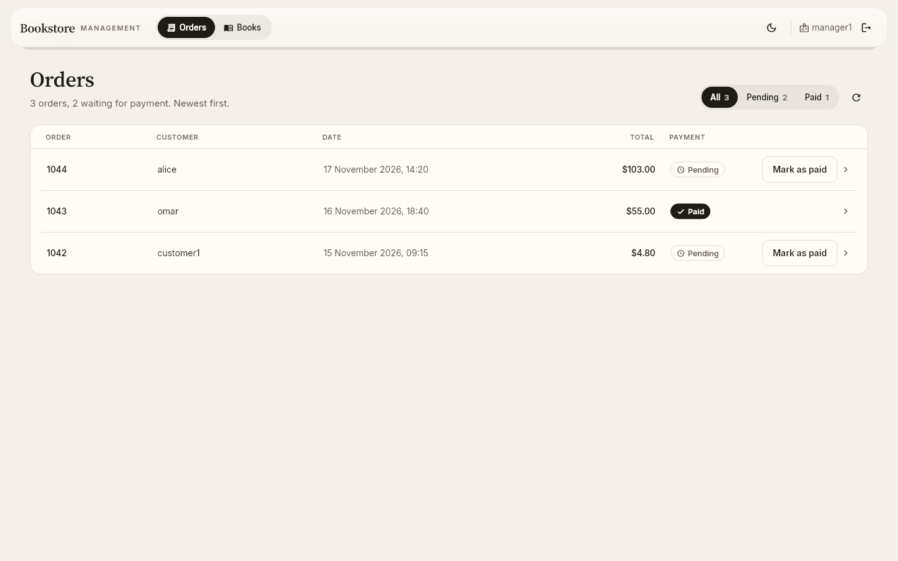
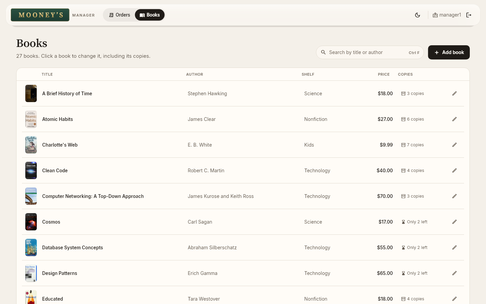
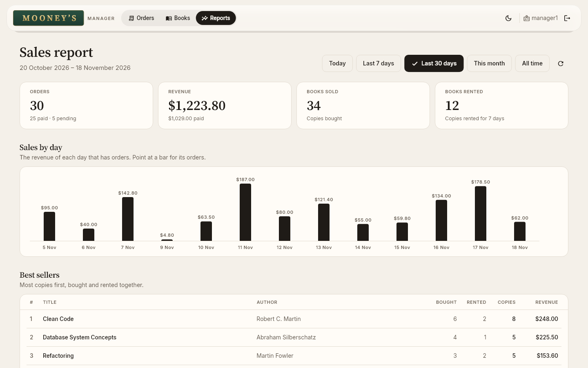

<h1 align="center">Mooney's</h1>

  <b>An online bookstore: the CSCE310 course project.</b> 
  Two Windows desktop apps and three RESTful web services, built from idea to release.

  <a href="https://github.com/KFUPMer/csce310-bookstore/releases/latest"><b>Download</b></a>
  &nbsp;·&nbsp;
  <a href="INSTALL.md"><b>Install</b></a>
  &nbsp;·&nbsp;
  <a href="HANDOVER.md"><b>Handover for the instructor</b></a>
  &nbsp;·&nbsp;
  <a href="CHANGELOG.md"><b>Changelog</b></a>

  

  

## What it is

**Mooney's** is a small bookshop you run on a Windows computer.

- **Customers** use the **Mooney's** app to search 81 books by title or author, browse five shelves, buy or rent books (renting costs 10% of the price, for 7 days), get an HTML bill by email, pay, see their orders, and review books with 1 to 5 stars.
- **Managers** use **Mooney's Manager** to see every order, mark orders as paid, print bills, add and change books, and read a sales report.

Behind the apps are three services: **user-service** (Java), **book-service** and **order-service** (Python Flask), on MySQL and MongoDB.

This repository records the **whole process**, not only the final code: the idea and requirements, the design, the problems met and how they were solved, and the plan (milestones, tasks, deadlines, versions).

> [!IMPORTANT]
> **For the instructor:** [HANDOVER.md](HANDOVER.md) has everything needed to install, try, and grade the project, with a walk through every requirement.

## Screenshots

<table>
  <tr>
    <td width="50%" valign="top">
      
      
<b>The shop.</b> 81 books on five shelves, with real covers.

    </td>
    <td width="50%" valign="top">
      
      
<b>A book.</b> Buy, rent for 7 days, and read or write reviews.

    </td>
  </tr>
  <tr>
    <td width="50%" valign="top">
      
      
<b>The bill.</b> Made when the order is placed, saved as HTML, and emailed.

    </td>
    <td width="50%" valign="top">
      
      
<b>Your account.</b> Profile, preferences, rentals due back, every order.

    </td>
  </tr>
  <tr>
    <td width="50%" valign="top">
      
      
<b>Search as you type</b>, here in list view and dark mode.

    </td>
    <td width="50%" valign="top">
      
      
<b>Mooney's Manager.</b> Every order; mark one as paid.

    </td>
  </tr>
  <tr>
    <td width="50%" valign="top">
      
      
<b>Books.</b> Add a book, or change one, including its copies.

    </td>
    <td width="50%" valign="top">
      
      
<b>Sales report.</b> Orders, revenue, sales by day, and best sellers.

    </td>
  </tr>
</table>

Each screenshot in the table is the real app drawn by its Flutter tests; the picture at the top puts two of them in window frames (<code>tools/screenshots/make-hero.ps1</code>). Every screen, with the design behind it: <a href="docs/02-design/style-guide.md">style guide</a>.

## Try it

On Windows 10 or 11 (64-bit), in about 15 minutes. Full steps: [INSTALL.md](INSTALL.md).

1. **Install MySQL Server 8**, if it is not there yet. It is the only thing installed by hand.
2. **Download** `Mooneys-Server-<version>.zip` and `Mooneys-Apps-Setup-<version>.exe` from the [latest release](https://github.com/KFUPMer/csce310-bookstore/releases/latest).
3. **Unzip the server and run `setup.cmd`.** It installs what is missing (Java, Python, MongoDB), then creates the database, the books, and the demo data. It asks once for your MySQL root password, typed into MySQL itself.
4. **Run `start-services.cmd`**, then run the apps installer.
5. **Log in:**

   | App | Username | Password |
   |---|---|---|
   | Mooney's | `customer1` | `customer123` |
   | Mooney's, a demo customer with past orders and reviews | for example `omar.aziz` | `demo12345` |
   | Mooney's Manager | `manager1` | `manager123` |

> [!WARNING]
> The installer is not code-signed, so Windows warns about an "unknown publisher" (**More info**, then **Run anyway**). Where **Smart App Control** is on, Windows blocks it outright; [INSTALL.md](INSTALL.md) shows how to build the apps from the source instead.

## How it is built

  

| Service | Built with | Data | Port | What it does |
|---|---|---|---|---|
| **user-service** | Java 21, built-in HttpServer | MySQL | 8081 | Accounts, registration, login, sessions, roles; passwords hashed with bcrypt |
| **book-service** | Python, Flask | MongoDB | 8082 | Search, add and change books; reviews and star ratings |
| **order-service** | Python, Flask | MySQL | 8083 | Orders, HTML bills (saved and emailed), payment status, sales report |

| App | For | Built with |
|---|---|---|
| **Mooney's** (`clients/customer-app`) | Customers | Flutter, Windows desktop |
| **Mooney's Manager** (`clients/management-app`) | Managers | Flutter, Windows desktop |
| `clients/bookstore-ui` | Both apps: the shared look, log-in form, and service clients | Flutter package |

Every service has the same four layers and one error shape, `{ "error": "…" }`; the rules are in [engineering-rules.md](docs/02-design/engineering-rules.md). The services listen only on this computer, never the network. Every endpoint, request, and answer: [api-design.md](docs/02-design/api-design.md).

## By the numbers

| | |
|---|---|
| **Requirements** | All 14 functional (FR1–FR14) and 5 non-functional (N1–N5) met, each with evidence: [requirements test report](docs/06-testing/requirements-test.md) |
| **Extra credit** | All 6 items: registration, emailed bills, a modern GUI framework (Flutter), and the three of the course's section 6: profiles with order history, book reviews and ratings, a sales report |
| **Tests** | 333 automated tests, all passing, plus 41 checks against the three running services |
| **Speed** | N1 allows 500 ms per call. In every recorded run of the 41 live checks, each started cold, the slowest order call took 176 ms or less |
| **Design** | 23 diagrams in draw.io (UML, ER, architecture, wireframes), each as source and image |
| **Process** | 6 milestones, 21 GitHub issues, 9 releases (7 versions and 2 betas), 22 problem-log entries, 51 enhancement-log entries |

<b>Tests per part</b>

| Part | Tests |
|---|---|
| user-service | 26 |
| book-service | 71 |
| order-service | 117 |
| Shared package `bookstore-ui` | 40 |
| Customer app (Mooney's) | 46 |
| Management app (Mooney's Manager) | 33 |
| **Total** | **333** |

Commands for each are in the [requirements test report](docs/06-testing/requirements-test.md). The release build on GitHub runs every suite before it builds.

## Project status

| Phase | Milestone | Version | Released |
|---|---|---|---|
| 1. Idea and requirements | M1 | v0.1.0 | 2026-11-13 |
| 2. Design | M2 | v0.2.0 | 2026-11-13 |
| 3. Backend services | M3 | v0.3.0 | 2026-11-17 |
| 4. Desktop clients | M4 | v0.4.0 | 2026-11-17 |
| 5. Testing and final release | M5 | v1.0.0 | 2026-11-17 |
| 6. Extra credit (course section 6) | M6 | v1.1.0 | 2026-11-18 |
| A full shop: 81 books and demo sales | — | v1.2.0 | 2026-11-18 |

Every milestone is closed; the course deadline is 2026-12-04. Dates, tasks, and dated progress notes: [milestones.md](docs/04-planning/milestones.md).

## How to read this repository

| Where | What is in it |
|---|---|
| [docs/01-idea](docs/01-idea/project-idea.md) | What we are building and why: scope and requirements |
| [docs/02-design](docs/02-design/architecture.md) | [Architecture](docs/02-design/architecture.md), [use cases](docs/02-design/use-cases.md), [UML diagrams](docs/02-design/uml-diagrams.md), [class diagrams](docs/02-design/class-diagrams.md), [database](docs/02-design/database-design.md), [API](docs/02-design/api-design.md), [UI](docs/02-design/ui-design.md), [style guide](docs/02-design/style-guide.md), [bill](docs/02-design/bill-design.md), [engineering rules](docs/02-design/engineering-rules.md) |
| [docs/03-problems](docs/03-problems/problem-log.md) | The [problem log](docs/03-problems/problem-log.md): what went wrong, who caused it, how it was fixed. The [enhancement log](docs/03-problems/enhancement-log.md): what was made better than required, and its measured effect |
| [docs/04-planning](docs/04-planning/milestones.md) | [Milestones](docs/04-planning/milestones.md), tasks, deadlines, and [versioning rules](docs/04-planning/versioning.md) |
| [docs/05-setup](docs/05-setup/environment.md) | The development environment: every tool, its version, and how to check it |
| [docs/06-testing](docs/06-testing/requirements-test.md) | The requirements test report: every requirement and the tests that prove it |
| [docs/07-report](docs/07-report/README.md) | The course report (database, API, screens, architecture and classes) and the script for the acceptance-test videos |
| [services/](services/README.md) | The three web services, each with a README on how to run and test it |
| [clients/](clients/README.md) | The two desktop apps and their shared package |
| [database/](database/README.md) | MySQL schema, the books, the seed and demo-data scripts |
| `setup.cmd`, `start-services.cmd`, `stop-services.cmd`, `scripts/` | Set up, start, and stop the services on any Windows computer ([INSTALL.md](INSTALL.md)) |
| `installer/`, `.github/workflows/` | The apps' installer and the release build on GitHub Actions |
| [tools/diagrams](tools/diagrams/README.md) | How the draw.io diagrams are made and exported |
| [HANDOVER.md](HANDOVER.md), [INSTALL.md](INSTALL.md), [CHANGELOG.md](CHANGELOG.md) | For the instructor; how to install; what changed in every version |
| [REFERENCES.md](REFERENCES.md) | Everything that came from someone else, with its source and license |
| [CLAUDE.md](CLAUDE.md) | Notes for the AI assistant: the standing rules, where things stand, what is next |

## How the work was done

1. Each milestone has a deadline; each task is a GitHub issue in a milestone, closed with a note of what was done.
2. Code and its documentation go in the same commit: class diagrams, the file map, and the logs are updated as the code changes.
3. When a milestone is complete, `main` is tagged and a GitHub release is published. Pushing the tag makes GitHub Actions run every test suite, build the installer and the zips, and test the installer.
4. Anything that went wrong, including the assistant's own mistakes, goes in the [problem log](docs/03-problems/problem-log.md); anything made better than required, with its measured effect, in the [enhancement log](docs/03-problems/enhancement-log.md).
5. Anything taken from outside is listed in [REFERENCES.md](REFERENCES.md), with its version and license.

Versions and patches: [versioning.md](docs/04-planning/versioning.md).

**AI assistant.** Much of the code, documentation, and diagrams was written with Claude (Anthropic), directed by the project owner, who made every decision. Details: [REFERENCES.md](REFERENCES.md#6-use-of-an-ai-assistant).

## License

This project's own code, documents, and diagrams are under the [MIT License](LICENSE). Third-party fonts, libraries, and the book covers (linked from Open Library, not stored here) keep their own terms, listed in [REFERENCES.md](REFERENCES.md).
