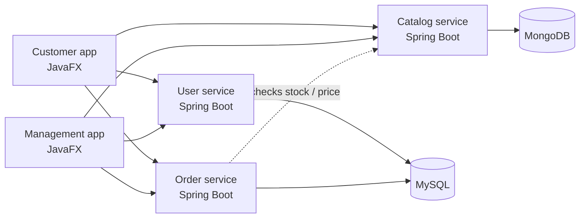

# Phase 2 — Architecture

> Status: **proposed starting point**. To be finalized in milestone M2.

## Overview

## Services (proposed)

| Service | Responsibility | Database | Port |
|---|---|---|---|
| user-service | Accounts, login, roles | MySQL | 8081 |
| catalog-service | Books, categories, stock, reviews | MongoDB | 8082 |
| order-service | Carts, orders, order status | MySQL | 8083 |

## Why each database

- **MySQL** for users and orders: fixed structure, relationships between tables, and orders need transactions.
- **MongoDB** for the catalog: book records vary (different attributes per book, nested reviews) and are read far more often than written.

## Clients

| Client | User | Main screens (proposed) |
|---|---|---|
| customer-app | Customer | Login, catalog/search, book details, cart, order history |
| management-app | Staff | Login, book management, stock, orders |

## Design decisions

Record each significant decision here as it is made.

| # | Date | Decision | Alternatives considered | Reason |
|---|---|---|---|---|
| 1 | 2026-11-13 | Spring Boot for services | Plain Java servlets, Python Flask | Standard for Java REST APIs; built-in MySQL and MongoDB support |
| 2 | 2026-11-13 | JavaFX for clients | Swing | More modern UI toolkit, FXML separates layout from logic |

## Still to design in M2

- [ ] Use case diagram
- [ ] Class diagrams per service
- [ ] Sequence diagram for "place an order"
- [ ] UI wireframes for both clients
- [ ] How login/authorization is passed between client and services
