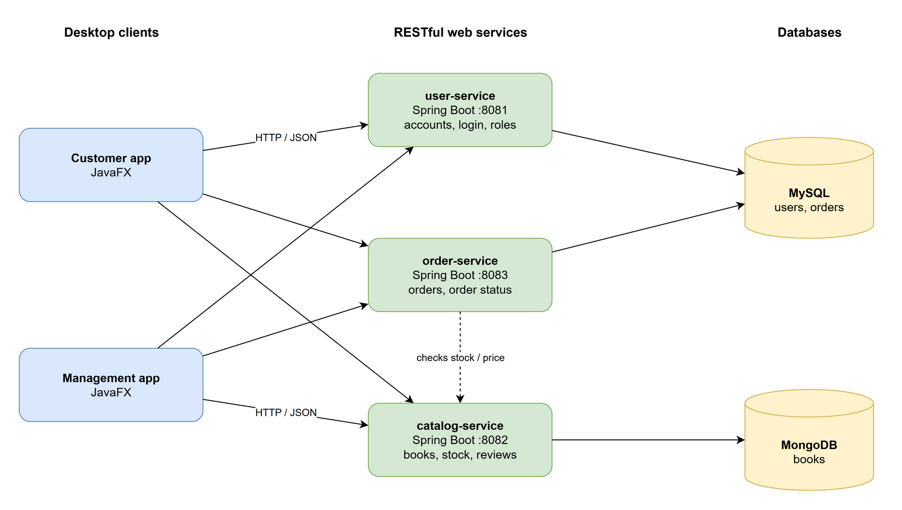

# Phase 2 — Architecture

> Status: **draft**, based on the official PRD. To be finalized in milestone M2.

## Overview

Source: [diagrams/architecture.drawio](diagrams/architecture.drawio)

## Services

| Service | Built with | Responsibility | Requirements | Database | Port |
|---|---|---|---|---|---|
| user-service | Java HttpServer | Login, logout, sessions, roles, registration | FR1, FR2, FR3, FR11 | MySQL | 8081 |
| book-service | Python Flask | Search books, add books, update book information | FR4, FR5, FR14 | MongoDB | 8082 |
| order-service | Python Flask | Create orders, generate and save the HTML bill, list orders, update payment status, email the bill | FR6–FR10, FR12, FR13 | MySQL | 8083 |

## Clients

| Client | User | Screens | Requirements |
|---|---|---|---|
| customer-app | Customer | Login, search and results list, selected books, bill confirmation | FR1, FR2, FR4–FR8 |
| management-app | Manager | Login, orders list with payment status, book add/update | FR11–FR14 |

## How a session works (FR1, FR2)

1. The client sends username and password to user-service.
2. user-service checks the password hash and returns a **session token**.
3. The client sends that token with every later request.
4. book-service and order-service ask user-service whether the token is valid and which role it belongs to.
5. Logging out deletes the session, so the token stops working.

Manager-only actions are refused unless the session belongs to a manager (FR11).

## How an order becomes a bill (FR7–FR9)

1. The customer app sends the selected books to order-service.
2. order-service takes the copies of each book through book-service. That one call checks copies are available, reduces them, and answers with the book's current title, author, and price. A bought book is charged at full price; a rented book at 10% of the price, due back in 7 days.
3. order-service saves the order in MySQL, in one transaction, with payment status `PENDING`. If anything in steps 2 or 3 fails, the copies already taken are given back and nothing is saved.
4. order-service writes the bill to `bills/bill-<orderId>.html` and returns it to the customer app.
5. order-service emails the bill to the customer, in the background.

## How the non-functional requirements are met

| ID | How |
|---|---|
| N1 (under 500 ms) | Small, simple queries; a search index on book title and author; response times measured during testing |
| N2 (no freezing) | Every call from a client to a service is a Dart `async` call returning a `Future`; the screen awaits it and shows a loading state, so the UI is never blocked |
| N3 (hashed passwords) | user-service hashes passwords with bcrypt before saving them |
| N4 (token required) | Every endpoint except login and register rejects requests without a valid session token |
| N5 (own data, own role) | Each endpoint checks the role: only customers place orders, only managers list all orders, change payment status, or add and update books. A customer can only open their own bill |

## Why each database

- **MySQL** for users, sessions, and orders: fixed structure with relationships, and an order must be saved as one transaction.
- **MongoDB** for the book catalog: simple documents that are searched by keyword far more often than they are changed.

## Design decisions

| # | Date | Decision | Alternatives considered | Reason |
|---|---|---|---|---|
| 1 | 2026-11-13 | Java HttpServer for user-service; Python Flask for book-service and order-service | Spring Boot for all three (first draft) | Required by PRD section 4.1 |
| 2 | 2026-11-13 | Flutter for both clients | Swing (the default), JavaFX (first choice), React Native | UI and UX quality is the priority: Flutter draws its own pixels, so animation is smooth and custom design is easy on Windows desktop. Earns +2%. React Native has weaker Windows desktop support |
| 3 | 2026-11-13 | Session token stored in MySQL | JWT | Simple to explain, and logout really ends the session (FR2) |
| 4 | 2026-11-13 | order-service generates the bill | A separate billing service | The bill is made at the moment the order is created; one less service |
| 5 | 2026-11-13 | order-service reduces book copies through a service-only endpoint protected by a shared key | Let customers call the manager endpoint; skip stock changes | Stock must go down when a book is ordered, but customers must not be able to change stock themselves (N5) |
| 6 | 2026-11-13 | If the bill email fails, the order still succeeds | Fail the whole order | The bill file is the required part (FR9); the email is a copy |
| 7 | 2026-11-13 | order-service sends bill emails through Gmail SMTP | A local test mail catcher | Real delivery for the demo. A test catcher can still be used during development by changing the settings only |
| 8 | 2026-11-13 | Repositories are interfaces, each with a MySQL and an in-memory version | Classes that talk to MySQL directly | The rules can be tested without a database, and a service can be run before the database exists |
| 9 | 2026-11-13 | Each service listens on both loopback addresses (127.0.0.1 and ::1), never on the network | IPv4 only | "localhost" can mean either; with only one, the first request waited about 2 seconds (P-004). Not listening on the network keeps the services private to this machine |
| 10 | 2026-11-13 | The services use a dedicated MySQL account (`bookstore_app`) limited to the bookstore database | The root account | Least privilege: the services get only the access they need, and the root password never has to be stored or shared |
| 11 | 2026-11-13 | user-service takes database connections from a pool and warms itself up at start-up | A new connection per query; no warm-up | Measured: a new connection per query made session checks about 75 ms and the first login over 500 ms. With the pool and warm-up they are under 20 ms and under 260 ms (P-005) |
| 12 | 2026-11-13 | bcrypt cost 10 in both the Java service and the Python seed script | The Python default of 12 | The same cost on both sides; cost 12 made each login about 300 ms, leaving little room under N1 |
| 13 | 2026-11-16 | The Python services are served by waitress | Flask's built-in development server | The built-in server is for development only and listens on one address; waitress is a production server and can listen on both loopback addresses (P-004) |
| 14 | 2026-11-16 | Taking copies of a book is one atomic database step | Read the number, check it, then write it | Two orders at the same moment must not both take the last copy. Tested with 20 simultaneous attempts |
| 15 | 2026-11-16 | If user-service does not answer within about 2 seconds, the other services answer 503 | Wait; or treat the user as logged out | A clear "try again" is better than a frozen app or a false "you are not logged in" |
| 16 | 2026-11-16 | order-service takes the copies first and saves the order second, giving the copies back if anything fails | Save the order, then reduce the copies (the first design); read the book, then reduce | Saving first could leave a saved order for a book that turned out to have no copies. The copies call is atomic and already returns the book, so it replaces the separate "get the book" call: one call per book instead of two |
| 17 | 2026-11-16 | The bill email is sent on a background thread, after the answer | Send it before answering | A mail server can take seconds; N1 allows 500 ms. The response says `emailQueued`, not `emailSent`, because delivery is not known yet |
| 18 | 2026-11-16 | A bill can always be made again from the saved order | Treat the file as the only copy | The bill shows only what is stored with the order and always says "Pending", so the same order gives the same bill. A deleted or unwritable file is not a lost bill |
| 19 | 2026-11-16 | Money is `Decimal` in order-service | `float`, as JSON gives it | Sums of prices and the 10% rent charge must be exact to the cent |
| 20 | 2026-11-16 | The two Flask services each keep their own copy of the error classes and the session check | A shared Python package | Each service is its own project and runs alone (PRD 4.1). The cost is that a fix must be made twice |

## Email settings (FR10)

order-service reads these from environment variables, kept in a local `.env` file that is not committed:

| Setting | Value |
|---|---|
| `SMTP_HOST` | `smtp.gmail.com` |
| `SMTP_PORT` | `587` (STARTTLS) |
| `SMTP_USER` | the Gmail address that sends the bills |
| `SMTP_PASSWORD` | a Gmail **app password** created for this project (not the account password) |
| `MAIL_FROM` | the name and address shown as the sender |

The file [services/.env.example](../../services/.env.example) lists the settings without any real values.

## Design checklist (M2, complete)

- [x] Use case, sequence, activity, state machine, component, object, and profile diagrams — see [uml-diagrams.md](uml-diagrams.md)
- [x] Class diagrams for both clients — see [class-diagrams.md](class-diagrams.md)
- [x] Class diagrams for the three services — see [uml-diagrams.md](uml-diagrams.md)
- [x] Use case descriptions — see [use-cases.md](use-cases.md)
- [x] UI wireframes for both clients — see [ui-design.md](ui-design.md)
- [x] Bill layout — see [bill-design.md](bill-design.md)
- [x] Visual style of the apps — [style-guide.md](style-guide.md), approved
