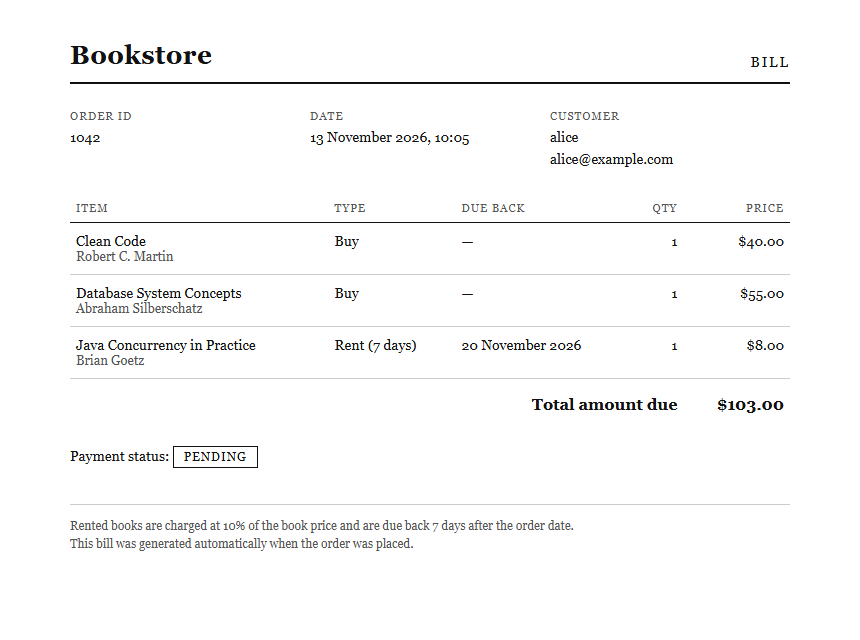

# Phase 2 — Bill design

> Status: **draft**. To be finalized in milestone M2.

When an order is placed, order-service generates a bill, saves it as an HTML file, and emails it to the customer (FR8, FR9, FR10).

## Sample

The sample itself: [bill/bill-sample.html](bill/bill-sample.html). Open it in a browser to see it and print it. Since M3 the sample is produced by order-service's own code (`order_service/bill.py`), so it is exactly what a real bill looks like.

## What is on the bill

| Part | Content | Required by |
|---|---|---|
| Order ID | The unique order number | FR8 |
| Date | When the order was placed | — |
| Customer | Username and email | FR9 (so the manager can post it) |
| Items | One row per book: title, author, buy or rent, due-back date if rented, quantity | FR8 |
| Individual prices | The price charged for each item | FR8 |
| Total amount due | The sum of the item prices | FR8 |
| Payment status | `Pending` when the bill is generated | FR13 |
| Footer | The renting rule in one sentence | FR7 |

## Decisions

| Decision | Reason |
|---|---|
| One self-contained HTML file: the styles are inside it, no images, no scripts | It must open and print anywhere, and it is also the body of the email |
| Laid out with tables, and styled through a wrapper inside the body, not with flex layout or styles on the body | Mail programs show less than browsers: Gmail ignored both, and the first real email arrived with a broken layout (problem P-016) |
| Saved as `bills/bill-<orderId>.html` | The order ID is unique, so the file name is too |
| Plain black on white with a serif font | It is a document to be printed and posted (FR9), not a screen |
| The bill always says `Pending` | It is generated once, at order time. The current status lives in the database and is shown in the manager app |
| Prices are the ones charged at order time | Later price changes must not alter an old bill |
