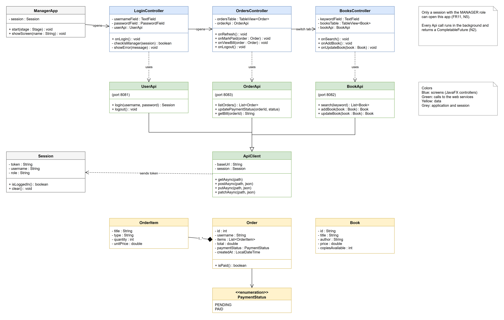

# Phase 2 — Class diagrams

> Status: **draft**. To be finalized in milestone M2.

The two desktop apps are separate JavaFX programs. Both are built the same way, in three layers:

| Layer | Color in the diagrams | What it does |
|---|---|---|
| Screens (controllers) | Blue | One class per screen; reacts to buttons and shows data |
| Service calls (`...Api`) | Green | One class per web service; sends HTTP requests with the session token |
| Data | Yellow | Plain objects such as `Book` and `Order` |

Every `...Api` class extends `ApiClient`, which sends each request in the background so the window never freezes (N2) and attaches the session token to it (N4).

## Customer app

Source: [diagrams/class-customer-app.drawio](diagrams/class-customer-app.drawio)

| Class | Purpose | Requirements |
|---|---|---|
| `LoginController` | Log in (and optionally register) | FR1, FR3 |
| `SearchController` | Search by keyword, show title/author/price, pick books, log out | FR2, FR4, FR5, FR6 |
| `OrderController` | Hold the selected books, choose buy or rent for each, place the order | FR6, FR7 |
| `BillController` | Show the bill returned for the order | FR8 |
| `UserApi`, `BookApi`, `OrderApi` | Calls to user-service, book-service, order-service | N2, N4 |
| `Book`, `OrderItem`, `Order`, `ItemType` | Data; `OrderItem` works out the charge (10% when rented) and the rent due date (7 days) | FR7 |

## Manager app

Source: [diagrams/class-manager-app.drawio](diagrams/class-manager-app.drawio)

| Class | Purpose | Requirements |
|---|---|---|
| `LoginController` | Log in; refuses anyone who is not a manager | FR1, FR11, N5 |
| `OrdersController` | List all orders, mark an order as paid, view its bill | FR12, FR13 |
| `BooksController` | Search books, add a new book, update a book | FR14 |
| `UserApi`, `OrderApi`, `BookApi` | Calls to user-service, order-service, book-service | N2, N4 |
| `Order`, `OrderItem`, `Book`, `PaymentStatus` | Data | FR12–FR14 |

## Still to do in M2

- [ ] Class diagrams for the three backend services
