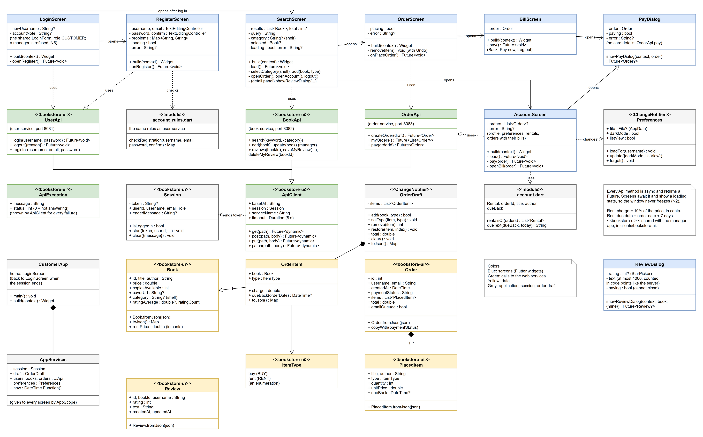

# Phase 2 — Class diagrams

> Status: **draft**. To be finalized in milestone M2.

The two desktop apps are separate Flutter programs, written in Dart. Both are built the same way, in three layers:

| Layer | Color in the diagrams | What it does |
|---|---|---|
| Screens | Blue | One widget per screen; shows data, reacts to buttons, and keeps the screen's own state (loading, error, selection) |
| Service calls (`...Api`) | Green | One class per web service; sends HTTP requests with the session token |
| Data | Yellow | Plain objects such as `Book` and `Order`, built from the JSON the services return |

Every `...Api` class extends `ApiClient`. All of its methods are `async` and return a `Future`: the screen awaits the answer and shows a loading state meanwhile, so the window never freezes (N2). `ApiClient` also attaches the session token to every request (N4).

## Customer app

Source: [diagrams/class-customer-app.drawio](diagrams/class-customer-app.drawio)

| Class | Purpose | Requirements |
|---|---|---|
| `LoginScreen` | Log in | FR1 |
| `RegisterScreen` | Create an account | FR3 |
| `SearchScreen` | Search by keyword, show title/author/price, add books to the order, log out | FR2, FR4, FR5, FR6 |
| `OrderScreen` | Review the selected books, choose buy or rent for each, place the order | FR6, FR7 |
| `BillScreen` | Show the bill returned for the order | FR8 |
| `OrderDraft` | The order being prepared, shared by the search and order screens | FR6 |
| `UserApi`, `BookApi`, `OrderApi` | Calls to user-service, book-service, order-service | N2, N4 |
| `Book`, `OrderItem`, `Order`, `ItemType` | Data; `OrderItem` works out the charge (10% when rented) and the rent due date (7 days) | FR7 |

## Manager app

Source: [diagrams/class-manager-app.drawio](diagrams/class-manager-app.drawio)

| Class | Purpose | Requirements |
|---|---|---|
| `LoginScreen` | Log in; refuses anyone who is not a manager | FR1, FR11, N5 |
| `OrdersScreen` | List all orders, mark an order as paid, view its bill | FR12, FR13 |
| `BooksScreen` | Search books, open the add or edit dialog | FR14 |
| `BookFormDialog` | Add a new book or edit an existing one | FR14 |
| `UserApi`, `OrderApi`, `BookApi` | Calls to user-service, order-service, book-service | N2, N4 |
| `Order`, `Book`, `PaymentStatus` | Data | FR12–FR14 |

## Shared UI package

Everything both apps have in common: the colors, typefaces, spacing, motion, and the reusable widgets. Explained in the [style guide](style-guide.md).

Source: [diagrams/class-bookstore-ui.drawio](diagrams/class-bookstore-ui.drawio)

## File map

Every source file that exists so far, and the classes in it. Updated in the same commit as the code ([engineering rules](engineering-rules.md)).

### clients/bookstore-ui

| File | Classes | Purpose |
|---|---|---|
| `lib/bookstore_ui.dart` | — | Exports everything below |
| `lib/src/tokens.dart` | `BookstoreColors`, `Space`, `Radii`, `Motion`, `Fonts` | The design values, in one place |
| `lib/src/theme.dart` | `buildBookstoreTheme()` | Builds the light or dark theme from the tokens |
| `lib/src/glass.dart` | `Glass` | Translucent blurred panel |
| `lib/src/book_cover.dart` | `BookCover` | A book cover; draws one from the title when there is no image |
| `lib/src/app_button.dart` | `AppButton`, `AppButtonStyle`, `AppIconButton` | Buttons with hover, press, focus, and loading states |
| `lib/src/smooth_scroll.dart` | `SmoothScroll` | Animated mouse-wheel scrolling |
| `lib/src/status_chip.dart` | `StatusChip` | A state shown as an icon and a word |
| `test/bookstore_ui_test.dart` | — | Tests that a title always gets the same cover color |

### clients/customer-app

| File | Classes | Purpose |
|---|---|---|
| `lib/main.dart` | `CustomerApp` | Starts the app, holds light or dark mode |
| `lib/models/book.dart` | `Book`, `ItemType`, `money()` | A book, with its rent price (10%) |
| `lib/screens/search_screen.dart` | `SearchScreen`, and its private parts: `_Heading`, `_SearchField`, `_Availability`, `_BookCard`, `_BookRow`, `_DetailPanel`, `_EmptyState`, `_OrderLine` | Search and browse books, add them to the order |
| `lib/preview/mock_books.dart` | `mockBooks` | Sample data for the style preview. **Removed in M4** |
| `test/book_test.dart` | — | Tests the rent price, availability, and reading a book from JSON |

Private classes (names starting with `_`) are pieces of one screen and are used nowhere else, so they are listed here and not drawn as separate boxes.

Not built yet, and so still only in the diagram above: `LoginScreen`, `RegisterScreen`, `OrderScreen`, `BillScreen`, `OrderDraft`, the `...Api` classes, `Session`, `Order`, `OrderItem`. In the preview, the order being prepared is kept inside `SearchScreen`; it moves to `OrderDraft` in M4.

### clients/management-app

Still the empty Flutter starter project. Built in M4.

## Backend services

An overview of all three services, drawn during design, is in [uml-diagrams.md](uml-diagrams.md). Each service gets its own detailed diagram here when it is built.

### user-service

Built, and verified against the real MySQL database. Every class is in the diagram.

Source: [diagrams/class-user-service.drawio](diagrams/class-user-service.drawio)

File map (`services/user-service/src/main/java/com/bookstore/user/`):

| File | Kind | Purpose |
|---|---|---|
| `UserServer.java` | Start-up | Builds the parts, connects them, warms up, listens on both loopback addresses |
| `config/Config.java` | Settings | Reads the port, storage mode, and MySQL settings from the environment or `.env` |
| `http/BaseHandler.java` | HTTP | Shared by all handlers: reads JSON, reads the token, writes JSON, and turns every error into a response in one place |
| `http/AuthHandler.java` | HTTP | `/api/auth/login`, `/logout`, `/session` |
| `http/UserHandler.java` | HTTP | `/api/users/register` |
| `http/Json.java` | HTTP | The one place that knows the JSON library |
| `http/dto/LoginRequest.java` | Request | Body of login, with its validation |
| `http/dto/RegisterRequest.java` | Request | Body of register, with its validation (lengths, email shape) |
| `http/dto/UserResponse.java` | Response | What callers are told about a user; never the password hash |
| `service/AuthService.java` | Rules | Login, logout, session check, registration |
| `service/PasswordHasher.java` | Rules | bcrypt hashing and checking (N3) |
| `service/TokenGenerator.java` | Rules | Random session tokens |
| `repository/UserRepository.java` | Database | What the rules need from user storage (interface) |
| `repository/SessionRepository.java` | Database | What the rules need from session storage (interface) |
| `repository/JdbcUserRepository.java` | Database | Users in MySQL |
| `repository/JdbcSessionRepository.java` | Database | Sessions in MySQL |
| `repository/InMemoryUserRepository.java` | Database | Users in memory, for tests and memory mode |
| `repository/InMemorySessionRepository.java` | Database | Sessions in memory, for tests and memory mode |
| `repository/Database.java` | Database | Lends out MySQL connections from a small pool |
| `model/User.java`, `Session.java`, `Role.java` | Data | Plain data |
| `error/ApiException.java` | Error | An error that is safe to show, with its HTTP status |
| `error/ValidationException.java` | Error | 400 |
| `error/UnauthorizedException.java` | Error | 401 |
| `error/ConflictException.java` | Error | 409 |
| `error/DataAccessException.java` | Error | Database failure; logged, answered as a plain 500 |

Tests (`src/test/java/com/bookstore/user/`): `service/AuthServiceTest` (10: the rules), `http/dto/RegisterRequestTest` (5: validation), `UserServerHttpTest` (11: every endpoint over real HTTP, success and each error).

**Changes from the design overview:** the overview had 7 classes; the built service has 27. Added: the two repository interfaces with an in-memory version of each (so the rules can be tested without MySQL), request and response records, the error classes, `BaseHandler`, `Config`, `Database`, `Json`, and `TokenGenerator`. Nothing in the overview was dropped.

### book-service

Built, and verified on the running service with user-service and MongoDB. Every class and module is in the diagram.

Source: [diagrams/class-book-service.drawio](diagrams/class-book-service.drawio)

File map (`services/book-service/book_service/`):

| File | Kind | Holds | Purpose |
|---|---|---|---|
| `__main__.py` | Start-up | `main()` | Starts the server on both loopback addresses |
| `app.py` | HTTP | `create_app()`, `create_production_app()` | Puts the parts together; the only place that knows the concrete classes |
| `config.py` | Settings | `Config` | Port, MongoDB address, user-service address, service key |
| `routes.py` | HTTP | `create_routes()` | The five endpoints |
| `schemas.py` | Request | `BookInput`, `CopiesChange` | What a request must contain, with validation |
| `auth.py` | Rules | `SessionChecker`, `UserServiceSessionChecker`, `token_from()`, `require_manager()`, `require_service_key()` | Who is asking, and whether they may |
| `services.py` | Rules | `BookService` | Search, get, add, update, change copies |
| `repository.py` | Database | `BookRepository`, `MongoBookRepository`, `InMemoryBookRepository` | Reading and writing books |
| `models.py` | Data | `Book`, `CurrentUser` | Plain data |
| `errors.py` | Error | `ApiError` and its six subclasses, `register_error_handlers()` | The errors, and the one place that answers them |

Tests (`services/book-service/tests/`): `test_api.py` (24: every endpoint, success and each error), `test_mongo_repository.py` (7: against a real MongoDB), `fakes.py` (the stand-in for user-service).

**Changes from the design overview:** the overview had 4 boxes for this service. Added: the request shapes with validation, the repository interface with an in-memory version, the error classes, `Config`, and `app.py`. Because Python groups functions in modules, `routes.py`, `auth.py`, `app.py`, and `errors.py` are drawn as modules rather than classes.

### order-service

Built, and verified on the running service with user-service, book-service, MySQL, and MongoDB. Every class and module is in the diagram.

Source: [diagrams/class-order-service.drawio](diagrams/class-order-service.drawio)

File map (`services/order-service/order_service/`):

| File | Kind | Holds | Purpose |
|---|---|---|---|
| `__main__.py` | Start-up | `main()` | Starts the server on both loopback addresses; a clear message if MySQL or a setting is wrong |
| `app.py` | HTTP | `create_app()`, `create_production_app()` | Puts the parts together; the only place that knows the concrete classes |
| `config.py` | Settings | `Config` | Port, MySQL, the other services' addresses, service key, bills folder, mail settings. Secrets are never printed |
| `routes.py` | HTTP | `create_routes()` | The four endpoints |
| `schemas.py` | Request | `OrderInput`, `OrderLine`, `PaymentStatusInput` | What a request must contain, with validation |
| `auth.py` | Rules | `SessionChecker`, `UserServiceSessionChecker`, `token_from()`, `require_customer()`, `require_manager()` | Who is asking, and whether they may |
| `services.py` | Rules | `OrderService`, `PlacedOrder` | Place an order (all or nothing), list, open a bill, set the payment status |
| `pricing.py` | Rules | `RENT_RATE`, `RENT_DAYS`, `charge_for()` | The renting rule (FR7), in one place |
| `bill.py` | Rules, files | `render_bill()`, `bill_file_name()`, `money()`, `BillStore` | Makes the bill from an order; saves and reads bill files |
| `catalog.py` | Other service | `BookCatalog`, `BookServiceCatalog` | Takes and gives back copies through book-service |
| `mailer.py` | Other service | `Mailer`, `SmtpMailer`, `NoMailer`, `build_message()` | Emails the bill in the background; a failure is logged, never raised |
| `repository.py` | Database | `OrderRepository`, `MySqlOrderRepository`, `InMemoryOrderRepository`, `create_pool()` | Reading and writing orders |
| `models.py` | Data | `Order`, `OrderItem`, `CurrentUser`, `CatalogBook` | Plain data; money is `Decimal` |
| `errors.py` | Error | `ApiError` and its six subclasses, `register_error_handlers()` | The errors, and the one place that answers them |

Also in `services/order-service/`: `manual_check.py`, which starts all three services and checks every endpoint for real.

Tests (`services/order-service/tests/`): `test_api.py` (37: every endpoint, success and each error), `test_rules.py` (17: prices, validation, settings), `test_bill.py` (13), `test_book_catalog.py` (7: against a small real web server), `test_mailer.py` (5), `test_mysql_repository.py` (8: against the real MySQL), `fakes.py` (stand-ins for user-service, book-service, and the mail server).

**Changes from the design overview:** the overview had `OrderService` with "repo, books, pricing, bills, mail" behind it; all five exist, each behind an interface or in its own module. Added: the request shapes with validation, the in-memory repository, the error classes, `Config`, `app.py`, and `PlacedOrder`. Changed: copies are taken before the order is saved, not after (architecture decision 16), and the email is sent in the background (decision 17).
