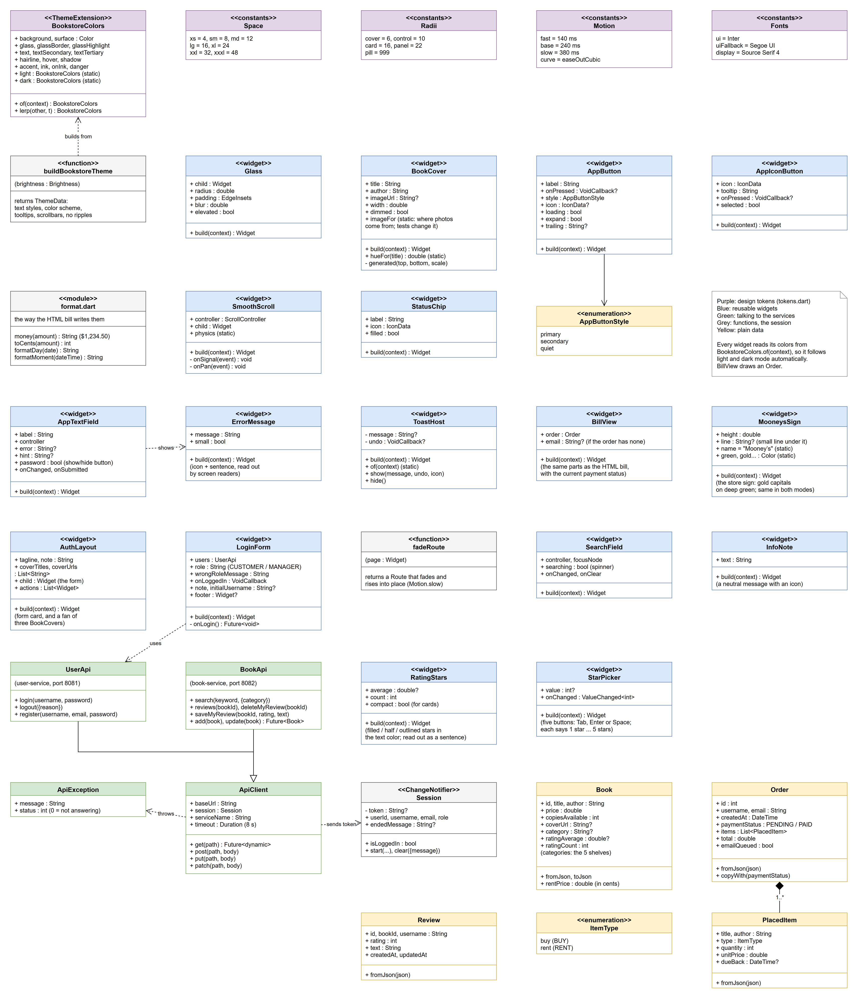
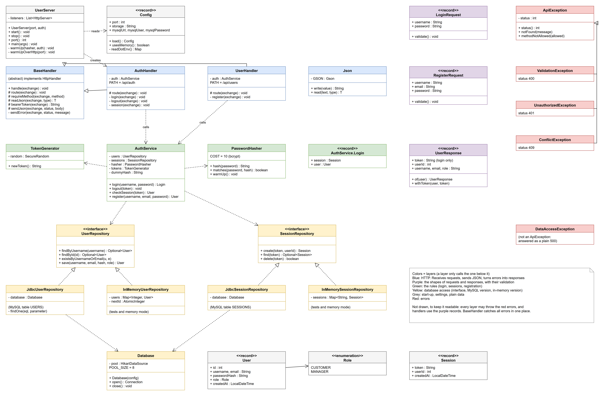
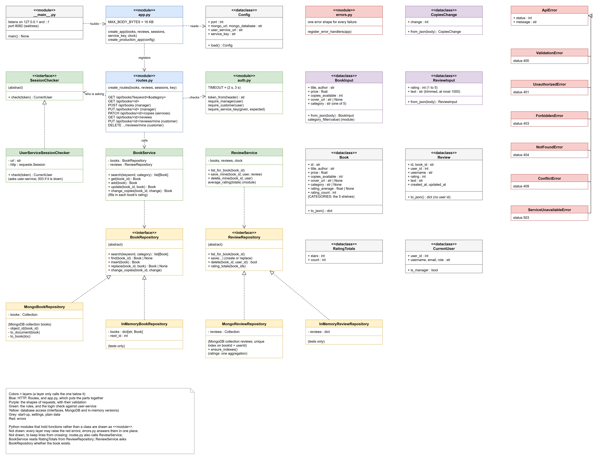
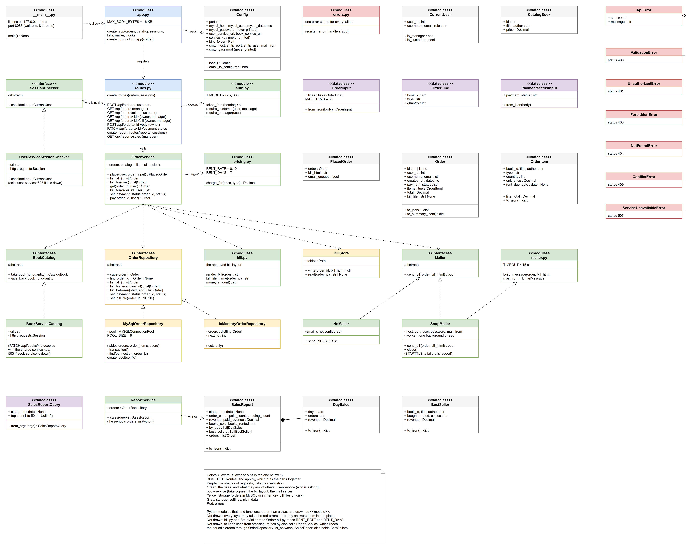

# Phase 2 — Class diagrams

> Status: **draft**. To be finalized in milestone M2.

The two desktop apps are separate Flutter programs, written in Dart. Both are built the same way, in three layers:

| Layer | Color in the diagrams | What it does |
|---|---|---|
| Screens | Blue | One widget per screen; shows data, reacts to buttons, and keeps the screen's own state (loading, error, selection) |
| Service calls (`...Api`) | Green | One class per web service; sends HTTP requests with the session token |
| Data | Yellow | Plain objects such as `Book` and `Order`, built from the JSON the services return |

Every `...Api` class extends `ApiClient`. All of its methods are `async` and return a `Future`: the screen awaits the answer and shows a loading state meanwhile, so the window never freezes (N2). `ApiClient` also attaches the session token to every request (N4).

## Customer app

Source: [diagrams/class-customer-app.drawio](diagrams/class-customer-app.drawio)

Built in M4; the diagram shows the app as built.

| Class | Purpose | Requirements |
|---|---|---|
| `LoginScreen` | Log in; refuses a manager account; shows why the last session ended | FR1, N5 |
| `RegisterScreen` | Create an account; each field's problem is shown under it before anything is sent | FR3 |
| `SearchScreen` | Search as you type, show title/author/price as covers or a list, add books to the order, log out. Since v1.1.0 each book shows its rating, and the detail panel lists its reviews, the customer's own first with Edit and Delete | FR2, FR4, FR5, FR6, extra credit |
| `OrderScreen` | Review the selected books, choose buy or rent for each, remove (with Undo), place the order | FR6, FR7 |
| `BillScreen` | Show the bill of the order just placed, and that a copy is being emailed; Pay now | FR8, FR10 |
| `PayDialog` (`showPayDialog`) | The pretend checkout: the total, a note that nothing is charged, and Pay; marks the order paid | Beyond the PRD |
| `AccountScreen` | Profile, preferences, rentals due back, and every order with its bill and Pay | Beyond the PRD |
| `Preferences` | Dark mode and covers-or-list for each customer, remembered on this computer | Beyond the PRD |
| `account.dart` (`Rental`, `rentalsOf`, `dueText`) | The rented books of the orders, soonest due first, and "Due back in 3 days" | FR7 |
| `ReviewDialog` (`showReviewDialog`) | Write or edit the customer's own review of a book: 1 to 5 stars and up to 1000 characters of text. Cannot be closed while a save is running | Extra credit (v1.1.0) |
| `Review`, `RatingStars`, `StarPicker` | From the shared package: a review as book-service returns it, the stars of a rating, and the five stars to choose from | Extra credit (v1.1.0) |
| `OrderDraft` | The order being prepared, kept by the app so it survives moving between screens and a failed attempt | FR6 |
| `Session` | Who is logged in; ending it sends the app back to the login screen | FR1, FR2, N4 |
| `UserApi`, `BookApi`, `OrderApi`, `ApiClient`, `ApiException` | Calls to the three services; every failure becomes one readable `ApiException` | N2, N4 |
| `Book`, `OrderItem`, `Order`, `PlacedItem`, `ItemType` | Data; `OrderItem` works out the charge (10% when rented, in whole cents) and the rent due date (7 days) | FR7, FR8 |
| `AppServices`, `AppScope`, `CustomerApp` | Holds the session, the order draft, the preferences, the clock, and the three services, and gives them to every screen | — |

## Manager app

Source: [diagrams/class-manager-app.drawio](diagrams/class-manager-app.drawio)

Built in M4; the diagram shows the app as built.

| Class | Purpose | Requirements |
|---|---|---|
| `LoginScreen` | Log in with the shared `LoginForm`; refuses anyone who is not a manager | FR1, FR11, N5 |
| `HomeScreen` | The glass bar with the Orders, Books, and Reports tabs, light/dark, the logged-in name (shortened with "..." when it does not fit, full name in a tooltip), and log out | FR2 |
| `OrdersView` | Every order, newest first, with a Pending/Paid filter; mark as paid (with Undo); open an order to see its bill, mark it paid or pending, and print it | FR8, FR9, FR12, FR13 |
| `BooksView` | Search books; open the add or edit dialog | FR14 |
| `BookFormDialog` | Add a new book or edit one, including its copies; each field's problem shown under it | FR14 |
| `ReportsView` | The sales report of a period (Today, Last 7 days, Last 30 days, This month, All time): four totals, sales by day as bars, the best sellers, and the period's orders. F5 refreshes | Extra credit (v1.1.0) |
| `OrderApi` | The manager's calls to order-service: list, one order, payment status, the HTML bill | N2, N4 |
| `ReportApi` | The call to `GET /api/reports/sales` in order-service | Extra credit, N2, N4 |
| `SalesReport`, `DayTotal`, `BestSeller`, `ReportPeriod` | Data of the report; `ReportPeriod` turns a period button into a range of whole days ending today | Extra credit (v1.1.0) |
| `ManagerServices`, `ManagerScope`, `ManagerApp` | Holds the session, the services, and the clock, and gives them to every screen | — |
| Shared: `UserApi`, `BookApi`, `ApiClient`, `Session`, `Order`, `Book` | From the shared package, the same classes as in the customer app | N2, N4 |

**Changes from the M2 design:** `OrdersScreen` and `BooksScreen` became two tabs (`OrdersView`, `BooksView`) of one `HomeScreen`, so switching keeps each tab's state. The bill is opened in a dialog in the app, through a new endpoint `GET /api/orders/{id}`, and "Print bill" opens the saved HTML in the browser (architecture decision 21). `PaymentStatus` is a plain `PENDING`/`PAID` text, as the service sends it. `UserApi`, `BookApi`, `ApiClient`, `Session`, `Order`, and `Book` are shared with the customer app instead of being written twice. Added: `book_rules.dart` (the same rules as book-service) and a filter with counts. Added for the extra credit in v1.1.0: the Reports tab (`ReportsView`), `ReportApi`, and `sales_report.dart` (architecture decision 26).

## Shared package

Everything both apps have in common: the colors, typefaces, spacing, motion, and the reusable widgets (explained in the [style guide](style-guide.md)), and, since M4, the way they talk to the services: the client, the session, and the book and order data. Engineering rule: no duplication between the two apps.

Source: [diagrams/class-bookstore-ui.drawio](diagrams/class-bookstore-ui.drawio)

## File map

Every source file that exists so far, and the classes in it. Updated in the same commit as the code ([engineering rules](engineering-rules.md)).

### clients/bookstore-ui

| File | Classes | Purpose |
|---|---|---|
| `lib/bookstore_ui.dart` | — | Exports everything below |
| `lib/src/tokens.dart` | `BookstoreColors`, `Space`, `Radii`, `Motion`, `Fonts` | The design values, in one place |
| `lib/src/theme.dart` | `buildBookstoreTheme()` | Builds the light or dark theme from the tokens |
| `lib/src/glass.dart` | `Glass` | Translucent blurred panel |
| `lib/src/book_cover.dart` | `BookCover` | A book cover; draws one from the title when there is no image |
| `lib/src/app_button.dart` | `AppButton`, `AppButtonStyle`, `AppIconButton` | Buttons with hover, press, focus, and loading states |
| `lib/src/smooth_scroll.dart` | `SmoothScroll` | Animated mouse-wheel scrolling |
| `lib/src/status_chip.dart` | `StatusChip` | A state shown as an icon and a word |
| `lib/src/format.dart` | `money()`, `toCents()`, `formatDay()`, `formatMoment()` | Money and dates written the way the HTML bill writes them; money rounded to the cent half up |
| `lib/src/app_text_field.dart` | `AppTextField`, `ErrorMessage` | A labelled field with its problem written under it; a problem said with an icon and a sentence. `lines` (since v1.1.0, default 1) makes a box of several lines, where Enter starts a new line |
| `lib/src/stars.dart` | `RatingStars`, `StarPicker`, `_StarPickerState`, `_PickStar`, `_PickStarState` | The stars of a rating, filled, half, or outlined in the text color, read out as one sentence ("Rated 4.3 out of 5 from 12 reviews"); a compact form for the cards. The five stars to choose a rating with, each a button with a tooltip, reached with Tab and chosen with Enter or Space |
| `lib/src/toast.dart` | `ToastHost`, `fadeRoute()` | The toast that confirms an action and offers Undo; the page change used everywhere |
| `lib/src/bill_view.dart` | `BillView` | The bill of an `Order` drawn in the app, with the same parts as the HTML bill |
| `lib/src/auth_layout.dart` | `AuthLayout`, `_CoverFan` | The layout of the log-in and create-account screens |
| `lib/src/login_form.dart` | `LoginForm`, `InfoNote` | The log-in form of both apps, letting in one role only; a neutral note with an icon |
| `lib/src/search_field.dart` | `SearchField` | The round search field of both apps; gives up its "Ctrl F" hint when narrow |
| `lib/src/mooneys_sign.dart` | `MooneysSign` | The store's sign: MOONEY'S in gold on deep green, in both apps |
| `lib/src/api/api_client.dart` | `ApiClient`, `ApiException` | Sends a request with the token, reads the answer, turns every failure into a readable message; uses dart:io, so no plugin is needed. `delete` since v1.1.0; an empty 204 answer is accepted |
| `lib/src/api/session.dart` | `Session` | Who is logged in |
| `lib/src/api/apis.dart` | `UserApi`, `BookApi`, the services' addresses | user-service and book-service, as both apps use them. Since v1.1.0 `BookApi` also lists a book's reviews and saves or deletes the customer's own (`reviews`, `saveMyReview`, `deleteMyReview`) |
| `lib/src/models/book.dart` | `Book`, `ItemType`, `rentPercent`, `rentDays`, `categories` | A book, with its shelf and its rent price (10%, in whole cents); the five shelves. Since v1.1.0 also `ratingAverage`, `ratingCount`, and `isRated`, read from book-service and never sent back |
| `lib/src/models/review.dart` | `Review` | A customer's review as book-service returns it; missing text becomes empty |
| `lib/src/models/order.dart` | `Order`, `PlacedItem` | An order as order-service returns it: a list row, or a whole order with its items |
| `test/bookstore_ui_test.dart` | — | Tests that a title always gets the same cover color |

### clients/customer-app

| File | Classes | Purpose |
|---|---|---|
| `lib/main.dart` | `CustomerApp`, `AppServices`, `AppScope` | Starts the app at the login screen, takes light or dark mode from the customer's preferences, gives the screens the session, the order draft, and the services; returns to log in when the session ends |
| `lib/api/apis.dart` | `OrderApi` | The customer's calls to order-service: place an order, my orders, pay (the other clients are shared) |
| `lib/models/order_draft.dart` | `OrderItem`, `OrderDraft` | The order being prepared |
| `lib/models/preferences.dart` | `Preferences` | Each customer's dark mode and covers-or-list, in a JSON file in AppData |
| `lib/models/account.dart` | `Rental`, `rentalsOf()`, `dueText()` | The rentals due back, and how long until each is due |
| `lib/models/account_rules.dart` | `checkRegistration()` | The account rules of user-service, checked in the app first |
| `lib/screens/login_screen.dart` | `LoginScreen` | Log in, with the shared `LoginForm`; opens Create an account |
| `lib/screens/register_screen.dart` | `RegisterScreen` | Create an account |
| `lib/screens/search_screen.dart` | `SearchScreen`, and its private parts: `_Heading`, `_Availability`, `_BookCard`, `_PlaceholderCard`, `_BookRow`, `_DetailPanel` (with `_DetailPanelState`), `_ReviewTile`, `_bookLabel()`, `_Message`, `_ShelfTabs`, `_ShelfTab` | Search and browse books by shelf, add them to the order. Since v1.1.0: the rating on each card and row, and in the detail panel the rating and the book's reviews ("Your review" first with Edit and Delete, Delete with Undo, then the others, newest first) |
| `lib/screens/order_screen.dart` | `OrderScreen`, `_ItemRow`, `_TypeChoice`, `_Segment`, `_Summary`, `_Empty` | Review and place the order |
| `lib/screens/bill_screen.dart` | `BillScreen` | The bill of the order just placed, with Pay now |
| `lib/screens/pay_dialog.dart` | `showPayDialog()`, `_PayDialog` | The pretend checkout |
| `lib/screens/review_dialog.dart` | `showReviewDialog()`, `_ReviewDialog`, `_ReviewDialogState`, `_ReviewLengthLimit`, `reviewLength()`, `reviewMaxLength` | Write or edit a review: the stars, up to 1000 characters with an "n / 1000" count, Save and Cancel. Length is counted in Unicode code points, as book-service counts it. Esc and a click outside do nothing while a save is running |
| `lib/screens/account_screen.dart` | `AccountScreen`, `_Card`, `_Field`, `_Preferences`, `_SwitchRow`, `_RentalRow`, `_OrderRow`, `_BillDialog` | The account page |

Tests (`clients/customer-app/test/`, 46): `order_draft_test.dart` (9), `account_rules_test.dart` (5), `account_test.dart` (6: rentals, due dates, preferences), `screens_test.dart` (26: every screen driven as a customer uses it, including a 1024 x 700 window, and 11 on reviews), `fakes.dart` (stand-ins for the services; the book stand-in keeps reviews and works out each book's rating from them), plus two that are skipped unless asked for: `live_services_test.dart` (the app's clients against the real running services; since v1.1.0 it also writes a review, checks it is listed first and counted in the rating, and deletes it again) and `screenshots_test.dart` (draws the screens to `docs/02-design/ui`).

Tests of the shared package (`clients/bookstore-ui/test/`, 40): `book_test.dart` (9: prices, money, shelves, rating), `order_test.dart` (1), `review_test.dart` (2), `api_client_test.dart` (17: against a small real web server, 6 of them on reviews), `stars_test.dart` (8: `RatingStars` and `StarPicker`, including Tab, Enter, and Space), `app_text_field_test.dart` (1: a field of several lines), `bookstore_ui_test.dart` (2).

Private classes (names starting with `_`) are pieces of one screen and are used nowhere else, so they are listed here and not drawn as separate boxes.

**Changes from the M2 design:** `OrderApi.getBill` was dropped (the bill comes back with the order). `Order` holds `PlacedItem`s, because order-service returns what was charged, not the book. `OrderItem` lost `quantity` (a book cannot be added twice). Added: `ApiException`, `AppServices`/`AppScope`, `account_rules.dart`, and `Session.endedMessage`. `RegisterScreen` now returns to `LoginScreen` (use case UC3) instead of opening the search. Added at the owner's request, beyond the PRD: `AccountScreen`, `PayDialog`, `Preferences`, and `account.dart` (architecture decision 23). Added for the extra credit in v1.1.0: `review_dialog.dart`, the reviews in `SearchScreen`, and the shared `Review`, `RatingStars`, and `StarPicker` (architecture decision 25).

### clients/management-app

| File | Classes | Purpose |
|---|---|---|
| `lib/main.dart` | `ManagerApp`, `ManagerServices`, `ManagerScope`, `FileOpener` | Starts the app at the login screen, holds light or dark mode, gives the screens the session and the services; returns to log in when the session ends. Since v1.1.0 `ManagerServices` also holds the `ReportApi` and the clock (`now`, `DateTime.now` unless a test gives a fixed time) |
| `lib/api/order_api.dart` | `OrderApi` | The manager's calls to order-service |
| `lib/api/report_api.dart` | `ReportApi` | The call to `GET /api/reports/sales`: sends the dates as YYYY-MM-DD, leaves out a date it was not given, and always sends `top` (10 unless asked otherwise) |
| `lib/models/book_rules.dart` | `checkBook()`, `BookCheck` | The book rules of book-service, shelf included, checked in the form first |
| `lib/models/sales_report.dart` | `SalesReport`, `DayTotal`, `BestSeller`, `ReportPeriod` | The report of a period, read from its JSON (money as numbers); one day's orders and revenue; one best seller's bought, rented, copies, and revenue. `ReportPeriod` is Today, Last 7 days, Last 30 days, This month, or All time, and turns into a range of whole days ending today (All time: no dates) |
| `lib/screens/login_screen.dart` | `LoginScreen` | Manager log in, with the shared `LoginForm` |
| `lib/screens/home_screen.dart` | `HomeScreen`, `Tabs`, `_Tab` | The glass bar and the tabs (Orders, Books, and since v1.1.0 Reports); `Tabs` is also the order filter. Since v1.1.0 the logged-in name is shortened with "..." when it does not fit, at any width, with the full name in a "Logged in as" tooltip |
| `lib/screens/orders_view.dart` | `OrdersView`, `_Table`, `_Row`, `_OrderDialog` | The orders, their payment status, and one order's bill |
| `lib/screens/books_view.dart` | `BooksView`, `_BookRow` | The books |
| `lib/screens/book_form_dialog.dart` | `BookFormDialog`, `_ShelfChoice` | Add or edit a book, and choose its shelf |
| `lib/screens/reports_view.dart` | `ReportsView`, and its private parts: `_ReportsViewState`, `_PeriodChoice`, `_ReportBody`, `_Section`, `_Tile`, `_DayChart`, `_Bar`, `_BestSellers`, `_Orders` | The Reports tab: the period buttons (the chosen one filled, with a check), the period in words, four tiles (Orders, Revenue, Books sold, Books rented), sales by day as bars in the ink color with the amount written over each when there is room (the last 31 days with orders at most), the best sellers as a numbered table, and the period's orders with a Paid/Pending chip. Loaded when the tab is opened and each time it is opened again; F5 refreshes; an answer for a period no longer chosen is dropped |
| `lib/screens/widgets.dart` | `Message` | The "nothing here" or "could not load" message of the tabs |

Tests (`clients/management-app/test/`, 33): `book_rules_test.dart` (7), `sales_report_test.dart` (7: reading the report, the periods across a month and a year, and `ReportApi` against a small real web server), `screens_test.dart` (18: every screen driven as a manager uses it, including a 1024 x 700 window; 5 on the Reports tab; a 50-character username at 1024, 1100, 1150, and 1440 px without overflowing), `home_bar_test.dart` (1: a usual username is shown in full at 1024 x 700, measured with the real typefaces), `fakes.dart` (stand-ins for the services, a fixed clock, a sample report of 30 orders, and `loadRealFonts`), plus `live_services_test.dart` and `screenshots_test.dart`, skipped unless asked for.

## Backend services

An overview of all three services, drawn during design, is in [uml-diagrams.md](uml-diagrams.md). Each service gets its own detailed diagram here when it is built.

### user-service

Built, and verified against the real MySQL database. Every class is in the diagram.

Source: [diagrams/class-user-service.drawio](diagrams/class-user-service.drawio)

File map (`services/user-service/src/main/java/com/bookstore/user/`):

| File | Kind | Purpose |
|---|---|---|
| `UserServer.java` | Start-up | Builds the parts, connects them, warms up, listens on both loopback addresses |
| `config/Config.java` | Settings | Reads the port, storage mode, and MySQL settings from the environment or `.env` |
| `http/BaseHandler.java` | HTTP | Shared by all handlers: reads JSON, reads the token, writes JSON, and turns every error into a response in one place |
| `http/AuthHandler.java` | HTTP | `/api/auth/login`, `/logout`, `/session` |
| `http/UserHandler.java` | HTTP | `/api/users/register` |
| `http/Json.java` | HTTP | The one place that knows the JSON library |
| `http/dto/LoginRequest.java` | Request | Body of login, with its validation |
| `http/dto/RegisterRequest.java` | Request | Body of register, with its validation (lengths, email shape) |
| `http/dto/UserResponse.java` | Response | What callers are told about a user; never the password hash |
| `service/AuthService.java` | Rules | Login, logout, session check, registration |
| `service/PasswordHasher.java` | Rules | bcrypt hashing and checking (N3) |
| `service/TokenGenerator.java` | Rules | Random session tokens |
| `repository/UserRepository.java` | Database | What the rules need from user storage (interface) |
| `repository/SessionRepository.java` | Database | What the rules need from session storage (interface) |
| `repository/JdbcUserRepository.java` | Database | Users in MySQL |
| `repository/JdbcSessionRepository.java` | Database | Sessions in MySQL |
| `repository/InMemoryUserRepository.java` | Database | Users in memory, for tests and memory mode |
| `repository/InMemorySessionRepository.java` | Database | Sessions in memory, for tests and memory mode |
| `repository/Database.java` | Database | Lends out MySQL connections from a small pool |
| `model/User.java`, `Session.java`, `Role.java` | Data | Plain data |
| `error/ApiException.java` | Error | An error that is safe to show, with its HTTP status |
| `error/ValidationException.java` | Error | 400 |
| `error/UnauthorizedException.java` | Error | 401 |
| `error/ConflictException.java` | Error | 409 |
| `error/DataAccessException.java` | Error | Database failure; logged, answered as a plain 500 |

Tests (`src/test/java/com/bookstore/user/`): `service/AuthServiceTest` (10: the rules), `http/dto/RegisterRequestTest` (5: validation), `UserServerHttpTest` (11: every endpoint over real HTTP, success and each error).

**Changes from the design overview:** the overview had 7 classes; the built service has 27. Added: the two repository interfaces with an in-memory version of each (so the rules can be tested without MySQL), request and response records, the error classes, `BaseHandler`, `Config`, `Database`, `Json`, and `TokenGenerator`. Nothing in the overview was dropped.

### book-service

Built, and verified on the running service with user-service and MongoDB. Every class and module is in the diagram.

Source: [diagrams/class-book-service.drawio](diagrams/class-book-service.drawio)

File map (`services/book-service/book_service/`):

| File | Kind | Holds | Purpose |
|---|---|---|---|
| `__main__.py` | Start-up | `main()` | Starts the server on both loopback addresses |
| `app.py` | HTTP | `create_app()`, `create_production_app()` | Puts the parts together; the only place that knows the concrete classes |
| `config.py` | Settings | `Config` | Port, MongoDB address, user-service address, service key |
| `routes.py` | HTTP | `create_routes()` | The eight endpoints: the five of the books, and since v1.1.0 the three of the reviews (list a book's reviews; save and delete the customer's own) |
| `schemas.py` | Request | `BookInput`, `CopiesChange`, `ReviewInput`, `category_filter()` | What a request must contain, with validation; the `?category=` of a search. `ReviewInput`: a rating that is a whole number from 1 to 5, and optional text of at most 1000 characters after trimming |
| `auth.py` | Rules | `SessionChecker`, `UserServiceSessionChecker`, `token_from()`, `require_manager()`, `require_customer()`, `require_service_key()` | Who is asking, and whether they may. `require_customer()` (v1.1.0): only a customer can review books |
| `services.py` | Rules | `BookService`, `ReviewService`, `average_rating()` | Search, get, add, update, change copies; every book answered with its rating, worked out from the reviews (one aggregation for a whole search). `ReviewService`: list a book's reviews, save or delete the customer's own, always under the book's own id. `average_rating()`: the average rounded half up to one decimal (4.25 becomes 4.3) |
| `repository.py` | Database | `BookRepository`, `MongoBookRepository`, `InMemoryBookRepository`, `ReviewRepository`, `MongoReviewRepository`, `InMemoryReviewRepository` | Reading and writing books and reviews. Reviews are in the MongoDB collection `reviews`, with the unique index `one_review_per_customer_per_book` on (`bookId`, `userId`); a save replaces the customer's earlier review and keeps when it was first written |
| `models.py` | Data | `Book`, `Review`, `RatingTotals`, `CurrentUser`, `CATEGORIES` | Plain data; the five shelves. `Book` has `ratingAverage` and `ratingCount` (v1.1.0); `Review` is one customer's review of one book; `RatingTotals` is the stars and the number of reviews of a book, added up |
| `errors.py` | Error | `ApiError` and its six subclasses, `register_error_handlers()` | The errors, and the one place that answers them |

Tests (`services/book-service/tests/`, 71): `test_api.py` (29: every endpoint, success and each error, shelves too), `test_reviews_api.py` (25: the three review endpoints, success and each error, a book id in any capitalisation, and the ratings on books), `test_mongo_repository.py` (17: against a real MongoDB; 9 on books, 8 on reviews, including the unique index), `fakes.py` (the stand-in for user-service, with a second customer).

**Changes from the design overview:** the overview had 4 boxes for this service. Added: the request shapes with validation, the repository interface with an in-memory version, the error classes, `Config`, and `app.py`. Because Python groups functions in modules, `routes.py`, `auth.py`, `app.py`, and `errors.py` are drawn as modules rather than classes. Added for the extra credit in v1.1.0: the reviews (`Review`, `RatingTotals`, `ReviewInput`, `ReviewService`, the review repositories, `require_customer()`) and the rating on every book (architecture decision 25).

### order-service

Built, and verified on the running service with user-service, book-service, MySQL, and MongoDB. Every class and module is in the diagram.

Source: [diagrams/class-order-service.drawio](diagrams/class-order-service.drawio)

File map (`services/order-service/order_service/`):

| File | Kind | Holds | Purpose |
|---|---|---|---|
| `__main__.py` | Start-up | `main()` | Starts the server on both loopback addresses; a clear message if MySQL or a setting is wrong |
| `app.py` | HTTP | `create_app()`, `create_production_app()` | Puts the parts together; the only place that knows the concrete classes |
| `config.py` | Settings | `Config` | Port, MySQL, the other services' addresses, service key, bills folder, mail settings. Secrets are never printed |
| `routes.py` | HTTP | `create_routes()`, `create_report_routes()` | The seven endpoints of the orders; since v1.1.0 also `GET /api/reports/sales`, for managers only |
| `schemas.py` | Request | `OrderInput`, `OrderLine`, `PaymentStatusInput`, `SalesReportQuery`, `_day()` | What a request must contain, with validation. `SalesReportQuery` (v1.1.0): the optional `from` and `to` dates, strictly YYYY-MM-DD, and `top`, a whole number from 1 to 50 (10 when left out) |
| `auth.py` | Rules | `SessionChecker`, `UserServiceSessionChecker`, `token_from()`, `require_customer()`, `require_manager()` | Who is asking, and whether they may |
| `services.py` | Rules | `OrderService`, `PlacedOrder`, `ReportService` | Place an order (all or nothing), list all or a customer's own, get one, open a bill, set the payment status, pay (pretend checkout). `ReportService` (v1.1.0): the sales report, added up in `Decimal` from the period's orders; the dates are inclusive (the period ends at midnight after the `to` day); best sellers grouped by book id, most copies first, then revenue, then title whatever its case |
| `pricing.py` | Rules | `RENT_RATE`, `RENT_DAYS`, `charge_for()` | The renting rule (FR7), in one place |
| `bill.py` | Rules, files | `render_bill()`, `bill_file_name()`, `money()`, `BillStore` | Makes the bill from an order; saves and reads bill files |
| `catalog.py` | Other service | `BookCatalog`, `BookServiceCatalog` | Takes and gives back copies through book-service |
| `mailer.py` | Other service | `Mailer`, `SmtpMailer`, `NoMailer`, `build_message()` | Emails the bill in the background; a failure is logged, never raised |
| `repository.py` | Database | `OrderRepository`, `MySqlOrderRepository`, `InMemoryOrderRepository`, `create_pool()` | Reading and writing orders. `list_between()` (v1.1.0): the orders from a start moment up to, not including, an end moment, newest first, with their items |
| `models.py` | Data | `Order`, `OrderItem`, `CurrentUser`, `CatalogBook`, `SalesReport`, `DaySales`, `BestSeller`, `_money()` | Plain data; money is `Decimal`. Since v1.1.0 the report, one day of it, and one best seller; `_money()` turns an amount into a number with two decimals for the report's JSON |
| `errors.py` | Error | `ApiError` and its six subclasses, `register_error_handlers()` | The errors, and the one place that answers them |

Also in `services/order-service/`: `manual_check.py`, which starts all three services and checks every endpoint for real, and `email_check.py`, which sends one real bill email.

Tests (`services/order-service/tests/`, 117): `test_api.py` (64: every endpoint, success and each error; 15 on the sales report, including the edges of a period and the order of tied best sellers), `test_rules.py` (17: prices, validation, settings), `test_bill.py` (14), `test_book_catalog.py` (7: against a small real web server), `test_mailer.py` (5), `test_mysql_repository.py` (10: against the real MySQL, including `list_between`), `fakes.py` (stand-ins for user-service, book-service, and the mail server).

**Changes from the design overview:** the overview had `OrderService` with "repo, books, pricing, bills, mail" behind it; all five exist, each behind an interface or in its own module. Added: the request shapes with validation, the in-memory repository, the error classes, `Config`, `app.py`, and `PlacedOrder`. Changed: copies are taken before the order is saved, not after (architecture decision 16), and the email is sent in the background (decision 17). Added for the extra credit in v1.1.0: the sales report (`ReportService`, `SalesReportQuery`, `SalesReport`, `DaySales`, `BestSeller`, `create_report_routes()`, `list_between()`; architecture decision 26).
