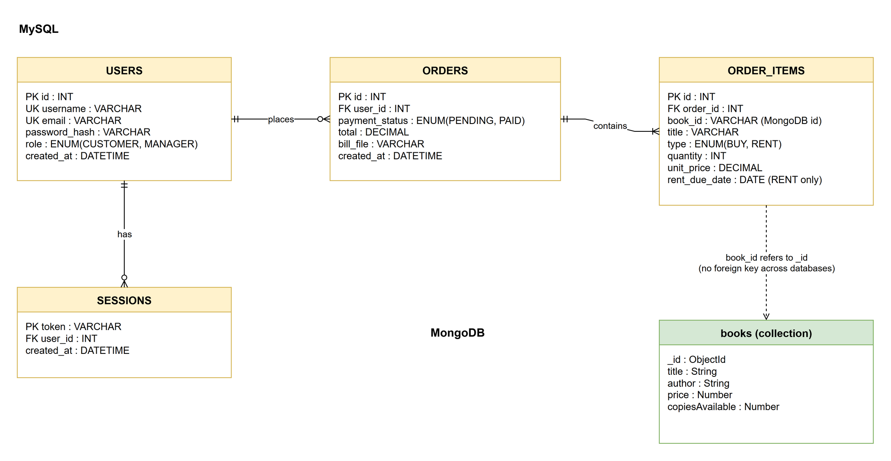

# Phase 2 — Database design

> Status: **draft**, based on the official PRD. To be finalized in milestone M2.

## Diagram



Source: [diagrams/database-er.drawio](diagrams/database-er.drawio)

## MySQL

| Table | Purpose | Requirements |
|---|---|---|
| `USERS` | Accounts with username, email, hashed password, and role (`CUSTOMER` or `MANAGER`) | FR1, FR3, FR11 |
| `SESSIONS` | One row per logged-in session; deleted on logout | FR2 |
| `ORDERS` | One row per order, with total and payment status (`PENDING` or `PAID`) | FR7, FR8, FR12, FR13 |
| `ORDER_ITEMS` | The books in an order, each with its type (`BUY` or `RENT`), the price charged, and a due date if rented | FR6, FR7, FR8 |

## MongoDB

Collection `books` (FR4, FR5, FR14):

```json
{
  "_id": "ObjectId",
  "title": "Example Title",
  "author": "Author Name",
  "price": 19.99,
  "copiesAvailable": 12
}
```

## Notes

- `ORDER_ITEMS.book_id` points to a MongoDB document, so there is no foreign key across databases. order-service checks the book through catalog-service.
- `title` and `unit_price` are copied into the order item, so the bill stays correct even if the book is changed later.
- Renting costs 10% of the book price and lasts 7 days. Books have no separate rent price: order-service calculates it, so for a `RENT` item `unit_price` = 10% of the book price and `rent_due_date` = order date + 7 days. For a `BUY` item `rent_due_date` is empty.

## Still to do in M2

- [ ] SQL schema script and seed data (at least one customer, one manager, some books)
- [ ] Index for keyword search on `title` and `author`
