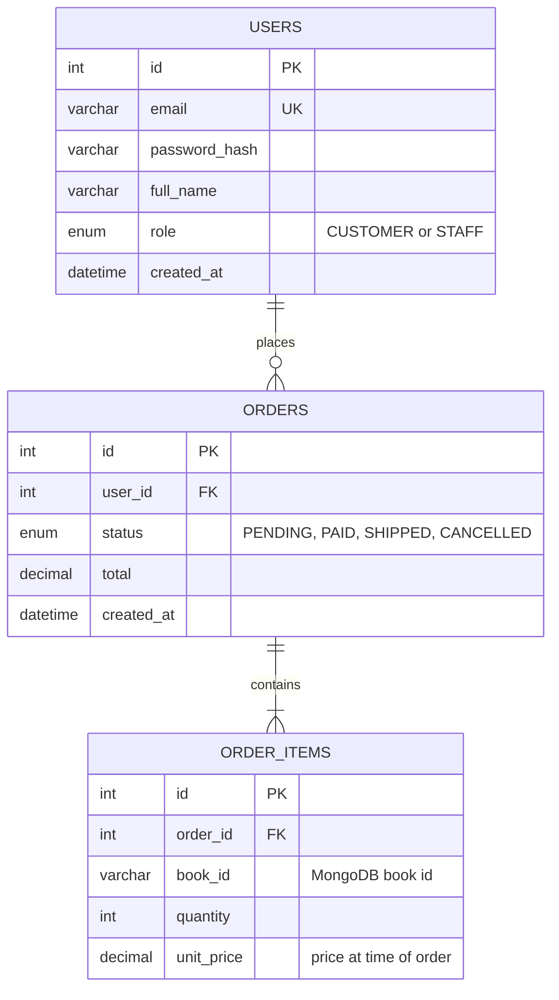

# Phase 2 — Database design

> Status: **proposed starting point**. To be finalized in milestone M2.

## MySQL (users and orders)



## MongoDB (catalog)

Collection `books`:

```json
{
  "_id": "ObjectId",
  "isbn": "9780000000000",
  "title": "Example Title",
  "authors": ["Author Name"],
  "categories": ["Fiction"],
  "price": 19.99,
  "stock": 12,
  "description": "…",
  "reviews": [
    { "userId": 5, "rating": 4, "comment": "…", "createdAt": "2026-11-13T00:00:00Z" }
  ]
}
```

## Notes

- `ORDER_ITEMS.book_id` points to a MongoDB document, so there is no foreign key across databases. The order service must validate the book through the catalog service.
- `unit_price` is copied into the order so later price changes do not alter past orders.

## Still to do in M2

- [ ] Normalization check for the MySQL schema
- [ ] Indexes (MySQL and MongoDB)
- [ ] SQL schema script and seed data
