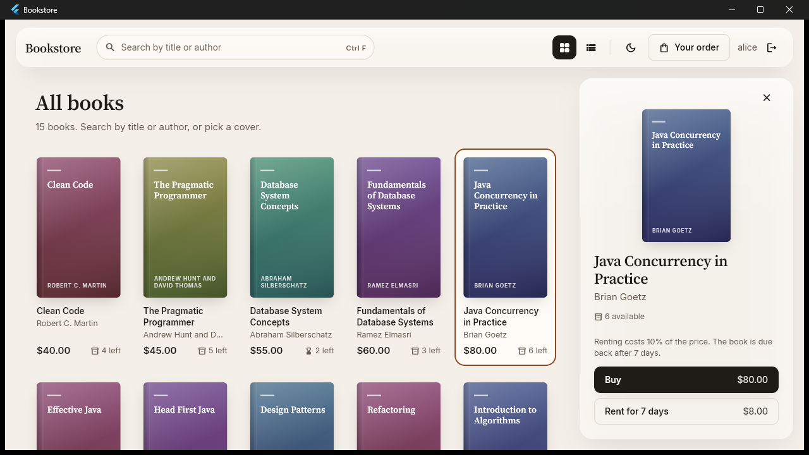

# Phase 2 — Visual style guide

> Status: **proposed, waiting for review.** Built as a working preview of one screen (the book catalog) so that it can be judged by looking at it. Nothing here is final until it has been seen running.

## The brief

In the project owner's words, turned into rules:

| Asked for | Rule |
|---|---|
| "As smooth as iOS and Apple UI, with glossy effects" | Floating translucent panels with blur ("glass"), soft shadows, rounded corners, short decelerating animations, a sheen on book covers |
| "Not colorful; the only thing that adds color is the books" | The whole interface is warm neutrals. Book covers are the only saturated color on screen |
| "Simple cozy colors that don't hurt the eye" | Off-white paper and warm near-black instead of pure white and pure black, in both modes |
| "Light and dark mode" | Two palettes with the same structure; one button switches between them |
| "Accessible for color-blind users" | Meaning is never carried by color alone; every text color passes WCAG AA contrast |
| "Books displayed smoothly, easy to check and search" | Cover grid with live search on title and author, a list view, and a detail panel that slides in |
| "Cover all of Nielsen's heuristics" | See [the table below](#nielsens-10-usability-heuristics) |

## Preview

The catalog screen of the customer app, running on sample data. These are real screenshots of the Flutter app, not mock-ups.

**Light**

**Light, with a book selected**

**Dark**

**Dark, with a book selected**

**List view with a search** (title, author, price in columns: FR5)

**Nothing found**

To run it: open the repository in VS Code, choose "Customer app" in Run and Debug, press F5.

## Color

Warm neutrals only. Every value lives in one file: [tokens.dart](../../clients/bookstore-ui/lib/src/tokens.dart).

| Role | Light | Dark | Used for |
|---|---|---|---|
| Background | `#F4F0E9` | `#151311` | The page |
| Surface | `#FFFCF7` | `#201D1A` | Selected cards, fields |
| Glass | Surface at 70%, over a blur | `#262220` at 60%, over a blur | Top bar, detail panel, toasts |
| Text | `#1F1B17` | `#F2EDE6` | Main text |
| Text, secondary | `#62594F` | `#B3A99D` | Authors, descriptions |
| Text, tertiary | `#746A5F` | `#8C8378` | Hints, small labels |
| Hairline | `#E2DBD0` | `#37322C` | Thin borders and separators |
| Ink | `#1F1B17` | `#F2EDE6` | The main button of a screen |
| Accent | `#8F4721` | `#E5A078` | Focus ring, selection outline. Used sparingly |
| Danger | `#9E2A1F` | `#F0A79C` | Error text, always with an icon |

**Book covers** are the color. A book with a cover image shows it. A book without one gets a generated cover: a muted color picked from its title (so the same book always looks the same), the title in a serif, and a sheen.

### Contrast (WCAG AA needs 4.5 : 1 for text)

Lowest ratio of each text color against the two backgrounds it sits on:

| Color | Light | Dark |
|---|---|---|
| Text | 15.1 | 14.4 |
| Text, secondary | 6.0 | 7.3 |
| Text, tertiary | 4.7 | 4.5 |
| Accent | 6.0 | 7.7 |
| Danger | 6.6 | 8.6 |
| Text on the main button | 16.7 | 15.4 |

## Type

| Use | Typeface | Why |
|---|---|---|
| Interface text | **Inter** | Open source and designed for screens; the closest free equivalent to Apple's SF Pro |
| Headings and titles on generated covers | **Source Serif 4** | A bookish serif, in the role Apple gives its "New York" typeface |

Apple's own SF Pro was considered and cannot be used: its license only allows it in software that runs on Apple platforms, and these are Windows apps. Inter and Source Serif 4 are under the SIL Open Font License, which allows bundling. Both are included in the shared package, with their license files, so the apps look the same on any machine.

| Style | Size | Weight |
|---|---|---|
| Page heading | 34 | Serif, semibold |
| Panel heading | 24 | Serif, semibold |
| Card title | 13.5 | Semibold |
| Body | 14–15 | Regular |
| Small text | 12.5 | Regular |
| Label | 11 | Semibold, wide spacing |

## Shape, depth, and glass

- **Spacing** uses one scale: 4, 8, 12, 16, 24, 32, 48.
- **Corners:** covers 6, controls 10, cards 16, panels 22, search field and chips fully round.
- **Glass:** panels that float above content are translucent with a blur behind them, a thin border, and a faint light edge on top. Content scrolls underneath, so the covers tint the bar as they pass.
- **Shadows** are large, soft, and low-contrast. No hard drop shadows.
- **No ripple effects.** Feedback is a quiet fill and a small change of size.

## Motion

| Speed | Time | Used for |
|---|---|---|
| Fast | 140 ms | Hover, press, focus |
| Base | 240 ms | Cards lifting, toasts, wheel scrolling |
| Slow | 380 ms | The detail panel, switching light and dark |

Everything decelerates into place (ease-out). Nothing bounces or loops.

- **Covers lift** slightly under the pointer.
- **The detail panel slides in** and the grid makes room for it instead of being covered.
- **Mouse-wheel scrolling glides.** Flutter moves a page in steps by default; the apps animate it instead.

## Accessibility

**Color-blind users**

- No state is told by color alone. Availability, "in your order", errors, and payment status all use an icon and a word.
- The interface is nearly gray-scale, so it looks almost the same with any type of color blindness.
- Generated cover colors are decoration only: the title and author are always in text.
- The accent and danger colors are both reddish-brown and can look alike to some users. That is why the accent is only an outline and errors always carry an icon and a sentence.

**Everyone else**

- Contrast passes WCAG AA for all text, in both modes.
- Everything works from the keyboard: Tab moves between controls, Enter activates, and focus is shown with a 2px outline.
- Every icon-only button has a tooltip, which is also its name for screen readers.
- Text sizes are never below 11.

## Nielsen's 10 usability heuristics

| # | Heuristic | How the design meets it | In the preview? |
|---|---|---|---|
| 1 | Visibility of system status | The heading always says what is shown ("3 of 15 books match"). Buttons show a spinner while a request runs. A toast confirms each action. The order button shows its item count | Yes, except spinners (no server yet) |
| 2 | Match between system and the real world | Books are shown as books, with covers. Plain words: "Buy", "Rent for 7 days", "Only 2 left". No codes or technical terms | Yes |
| 3 | User control and freedom | Every toast has Undo. Esc closes the panel, then clears the search. The order can be changed until it is placed | Undo and Esc: yes |
| 4 | Consistency and standards | One shared theme package for both apps: same buttons, spacing, and words everywhere. Standard shortcuts (Ctrl+F, Esc, Tab, Enter) | Yes |
| 5 | Error prevention | A book that cannot be ordered has disabled buttons and says why. A book cannot be added twice. Buttons are disabled while a request runs, so nothing is sent twice | Yes |
| 6 | Recognition rather than recall | Price, availability, and "in your order" are on every card. The rent price is shown on the button, not left to be calculated | Yes |
| 7 | Flexibility and efficiency of use | Covers view for browsing, list view for scanning. Search filters as you type. Keyboard shortcuts for frequent actions | Yes |
| 8 | Aesthetic and minimalist design | Neutral interface; only the covers have color. Each screen has one main button. Details appear only when a book is selected | Yes |
| 9 | Help users recognize, diagnose, and recover from errors | Messages say what happened and what to do, in plain words, next to where it happened. "No books match" suggests a fix and offers a button | Empty search: yes. Server errors: M4 |
| 10 | Help and documentation | Tooltips on every icon. Hints inside the search field. The renting rule is explained where the choice is made | Yes |

## What changes in the earlier design

- **The search screen is a cover grid, not a table.** The [wireframe](ui-design.md) showed a table; it becomes the optional list view. FR5 (title, author, price in a clear list) is met by both views.
- **Books get an optional cover image.** A new optional field `coverUrl` on a book. Without it, the generated cover is used.
- **One shared package**, [clients/bookstore-ui](../../clients/bookstore-ui), holds the theme and common widgets for both apps.

## Not checked yet

- **How the motion feels.** Screenshots cannot show it. Scrolling, hover, and the panel animation need to be tried by hand.
- **Trackpad scrolling.** Written, but only testable on a real trackpad.
- **Screen readers.** Labels are in place; they have not been tested with Windows Narrator.
- **A color-blindness simulation** of the screenshots has not been run.
- **Only one screen exists.** Login, register, order, bill, and the whole manager app still have to be built in this style.
