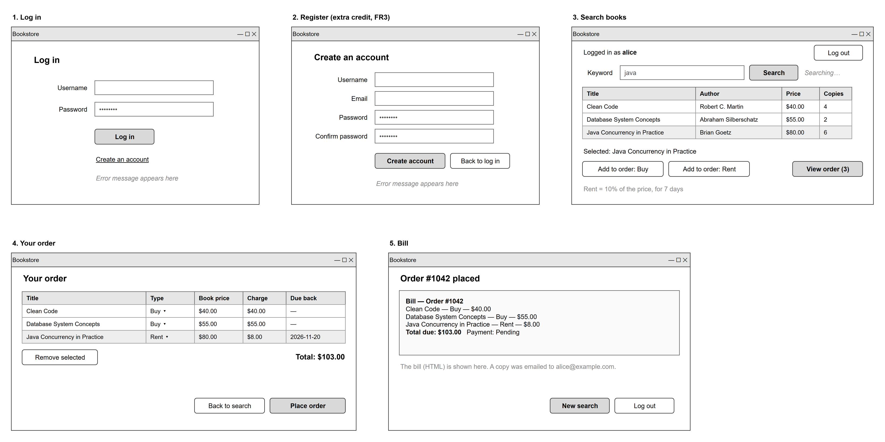
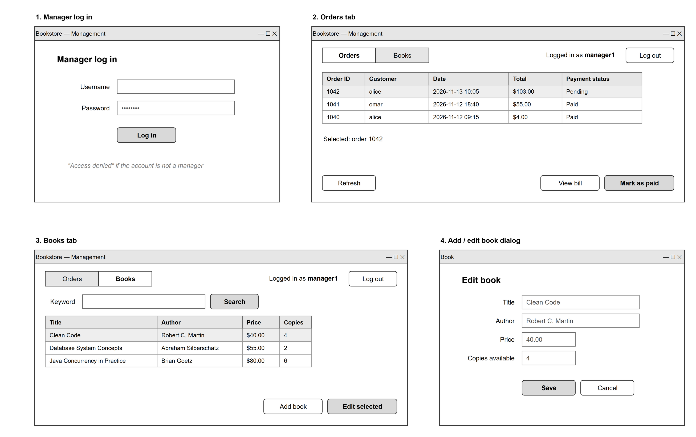

# Phase 2 — UI design

> Status: **wireframes drafted; visual style not decided.**

## 1. Wireframes (layout only)

Wireframes show **what is on each screen and where**. They are grey boxes on purpose. They are not how the apps will look.

### Customer app

| # | Screen | What the customer does | Requirements |
|---|---|---|---|
| 1 | Log in | Enters username and password | FR1 |
| 2 | Register | Creates an account | FR3 |
| 3 | Search books | Searches by keyword, sees title/author/price, adds books as Buy or Rent, logs out | FR2, FR4, FR5, FR6 |
| 4 | Your order | Reviews the books, switches Buy/Rent, removes books, sees the total, places the order | FR6, FR7 |
| 5 | Bill | Sees the bill for the order just placed | FR8, FR10 |

### Manager app

| # | Screen | What the manager does | Requirements |
|---|---|---|---|
| 1 | Manager log in | Logs in; a non-manager account is refused | FR1, FR11 |
| 2 | Orders tab | Sees all orders, views a bill, marks an order as paid | FR12, FR13 |
| 3 | Books tab | Searches books, starts adding or editing one | FR14 |
| 4 | Add / edit book | Enters title, author, price, copies | FR14 |

### Behaviour that the pictures do not show

- Every button that talks to a service disables itself and shows a short "Searching…" / "Saving…" text until the answer arrives. The window stays usable (N2).
- Errors appear as one line of text next to the form, not as pop-up dialogs.
- "Add to order" is disabled for a book with 0 copies. "Mark as paid" is disabled for an order that is already Paid.

## 2. Why Flutter

UI and UX quality is the top priority of this project, so both apps are built with Flutter: it draws every pixel itself, which makes smooth animation and a custom look much easier than in JavaFX or Swing.

## 3. Visual style (not decided yet)

The look of the apps is a separate decision from the layout, and it has not been made. It needs a real reference to aim at, otherwise the result is a generic template.

To decide:

- [ ] One or two existing apps or sites whose look to take as a reference
- [ ] Light, dark, or both
- [ ] Colors: background, text, one accent color
- [ ] Typeface for headings and for body text
- [ ] How dense the tables are (compact like a desktop tool, or spacious)

Constraints already known:

- These are desktop tools used with a mouse and keyboard, with tables as the main content. They should look like a desktop program, not like a phone app or a marketing web page.
- The bill is already designed as a plain printed document ([bill-design.md](bill-design.md)); the apps should not clash with it.

Once the style is decided, it is written here as a short style guide and applied through one shared Flutter theme used by both apps.
