# Phase 2 — UML diagrams

> Status: **draft**. To be finalized in milestone M2.

The UML diagrams of the bookstore. All are drawn in draw.io; each image has its source file next to it in [diagrams/](diagrams/README.md).

| # | Diagram | Kind | What it shows for this project |
|---|---|---|---|
| 1 | [Class](#1-class-diagrams) | Structural | The classes of the two apps and the three services |
| 2 | [Object](#2-object-diagram) | Structural | One real order at one moment, with actual values |
| 3 | [Component](#3-component-diagram) | Structural | The apps, services, and databases, and the interfaces between them |
| 4 | [Profile](#4-profile-diagram) | Structural | Our own labels (stereotypes) used across the diagrams |
| 5 | [Use case](#5-use-case-diagram) | Behavioral | What customers and managers can do, with [written descriptions](use-cases.md) |
| 6 | [Sequence](#6-sequence-diagrams) | Behavioral | The messages exchanged for login, register, placing an order, and updating payment |
| 7 | [Activity](#7-activity-diagrams) | Behavioral | The steps and decisions for login, placing an order, and updating payment |
| 8 | [State machine](#8-state-machine-diagram) | Behavioral | The states of an order and of a user session |

---

## Structural diagrams

### 1. Class diagrams

The classes of the two desktop apps are in [class-diagrams.md](class-diagrams.md). The classes of the three backend services:

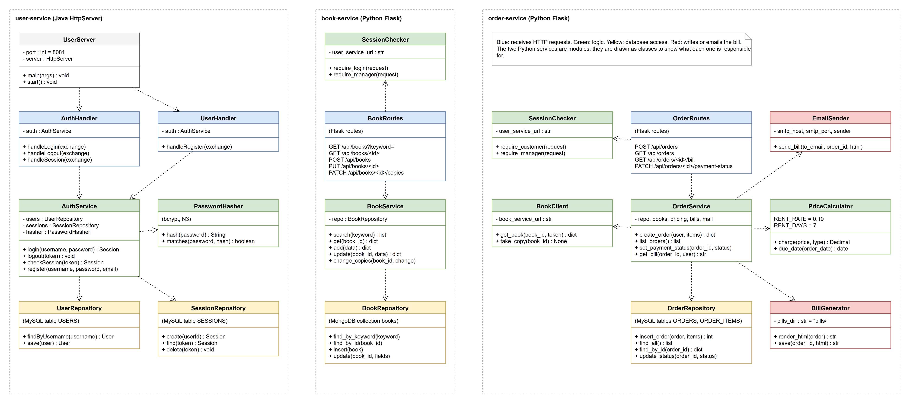

Each service has the same layers: a part that receives HTTP requests (blue), the logic (green), and database access (yellow). The two Python services are modules rather than classes; they are drawn as classes to show what each one is responsible for.

### 2. Object diagram

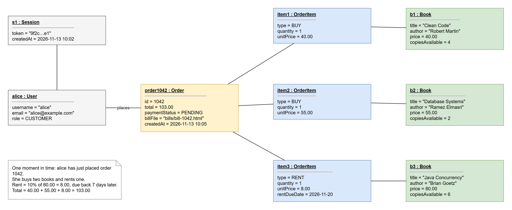

A snapshot of the example used throughout the docs: the customer `alice` has just placed order 1042, buying two books and renting one. It shows the renting rule with real numbers: the rented book costs 10% of 80.00 = 8.00 and is due back 7 days later.

### 3. Component diagram

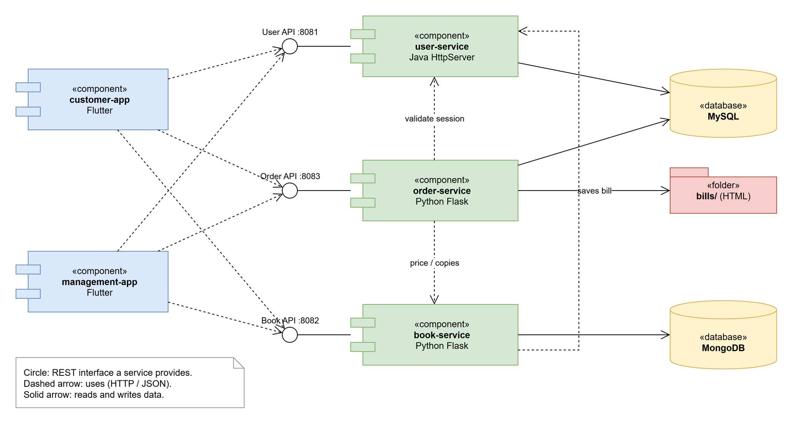

Each service provides one REST interface (the circles). Both apps use all three. order-service and book-service ask user-service to validate the session token, and order-service asks book-service for prices and available copies.

### 4. Profile diagram

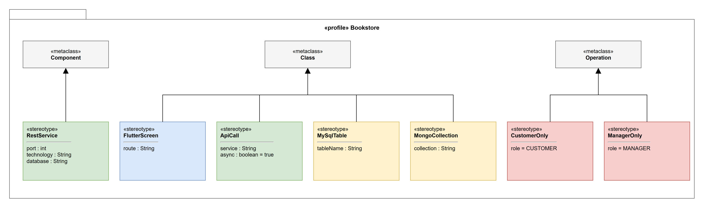

Stereotypes are our own labels that extend standard UML. Where each one applies:

| Stereotype | Applies to | Used for |
|---|---|---|
| `«RestService»` | Component | user-service, book-service, order-service |
| `«JavaFxScreen»` | Class | The controllers in both apps (`LoginController`, `SearchController`, ...) |
| `«ApiCall»` | Class | `UserApi`, `BookApi`, `OrderApi` |
| `«MySqlTable»` | Class | `USERS`, `SESSIONS`, `ORDERS`, `ORDER_ITEMS` |
| `«MongoCollection»` | Class | `books` |
| `«CustomerOnly»` | Operation | Placing an order |
| `«ManagerOnly»` | Operation | Listing all orders, updating payment status, adding and updating books |

---

## Behavioral diagrams

### 5. Use case diagram

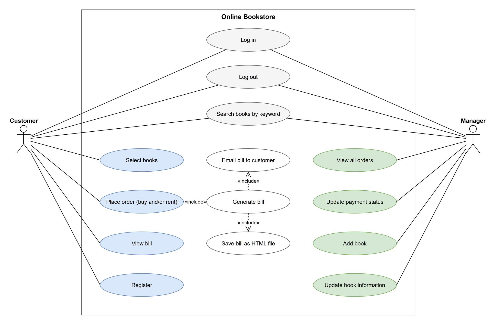

The written description of every use case (actor, steps, other flows, result) is in [use-cases.md](use-cases.md).

### 6. Sequence diagrams

One per main flow. All calls from the apps are asynchronous (N2).

**Log in** (FR1, FR2, FR11)

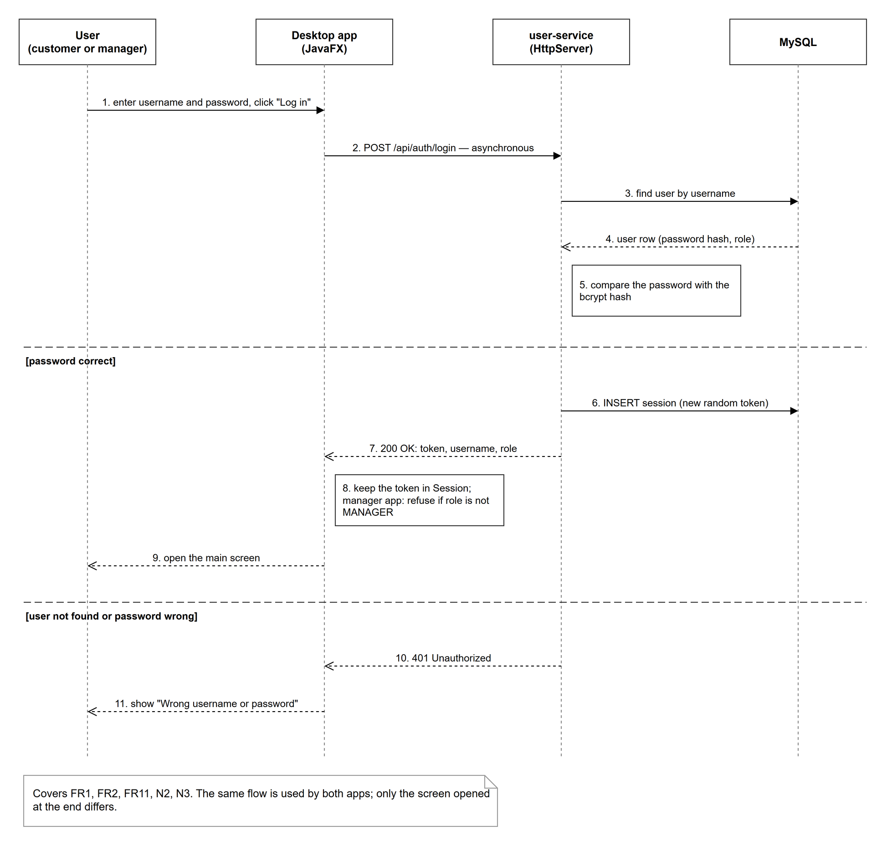

**Register** (FR3)

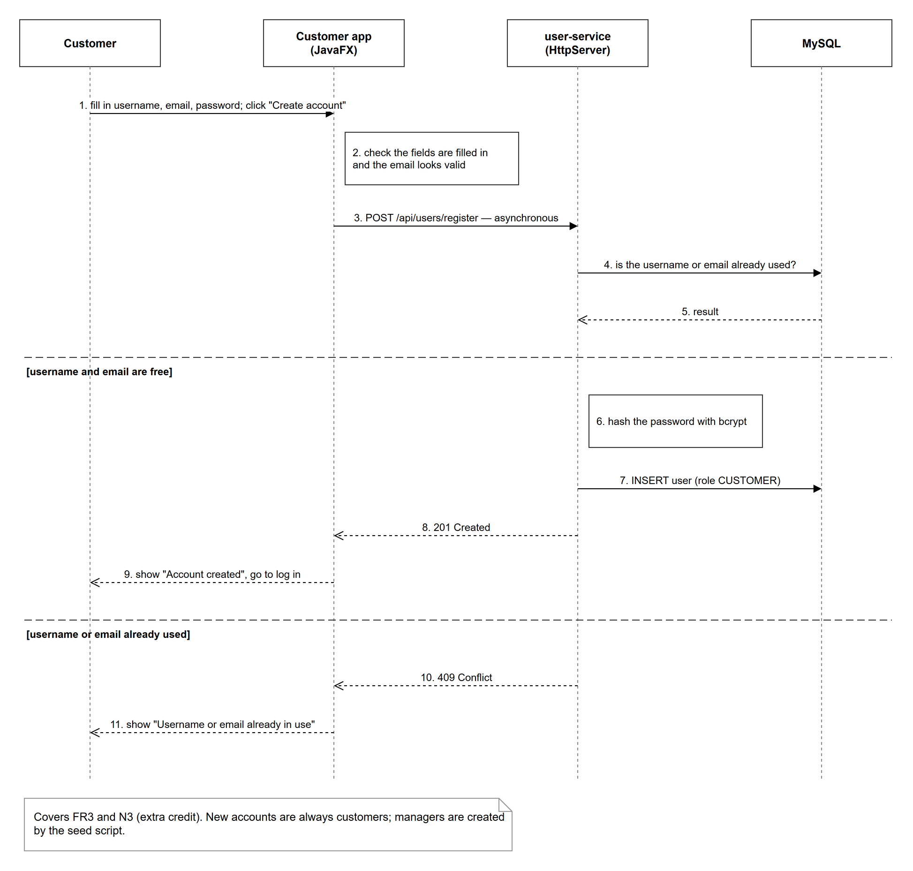

**Place an order** (FR6–FR10)

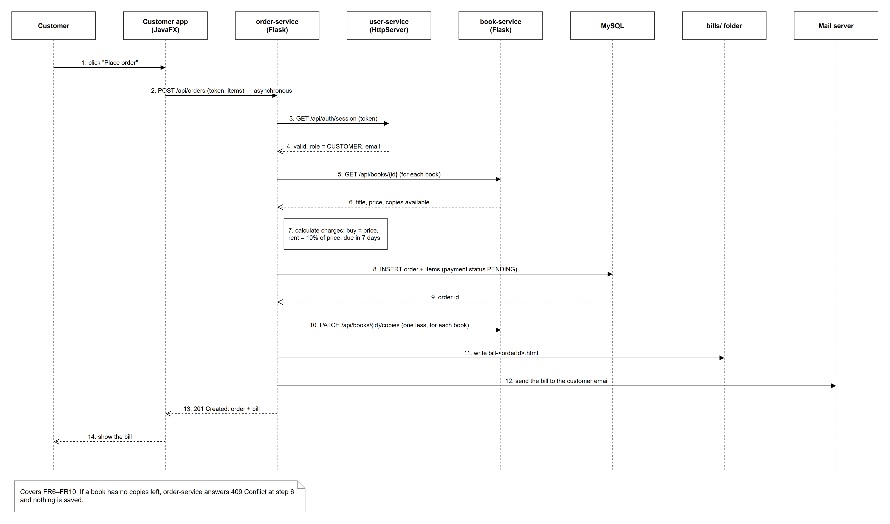

**Manager updates payment status** (FR12, FR13)

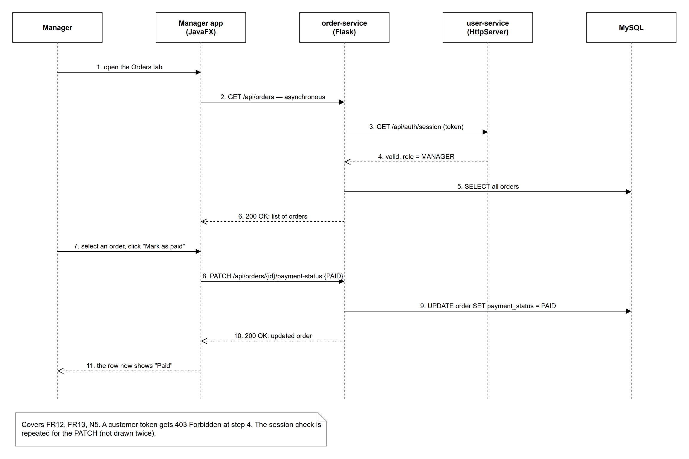

### 7. Activity diagrams

The same flows from the user's point of view: the steps and the decisions.

**Log in and register**

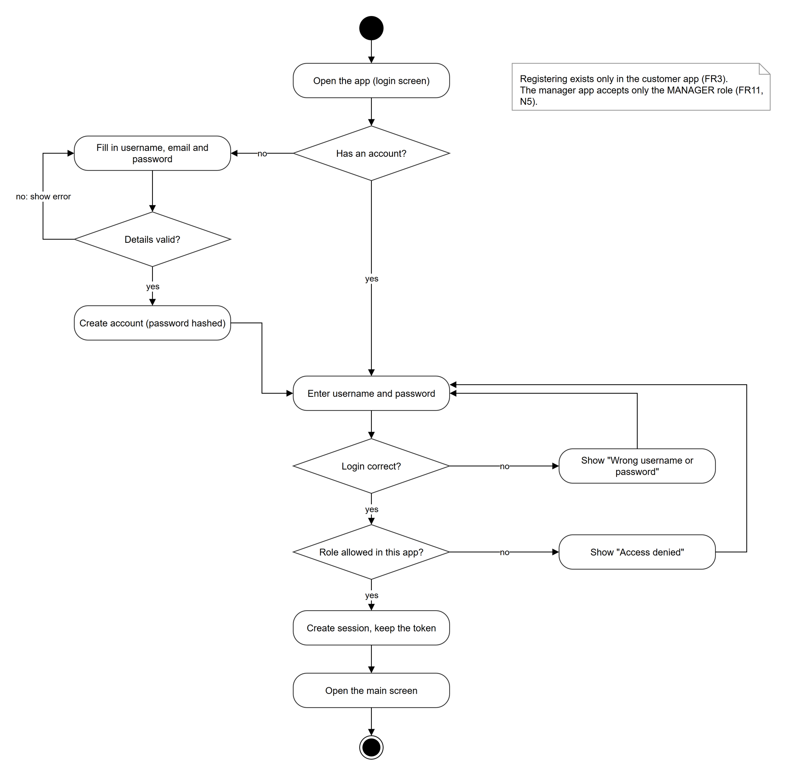

**Customer places an order**

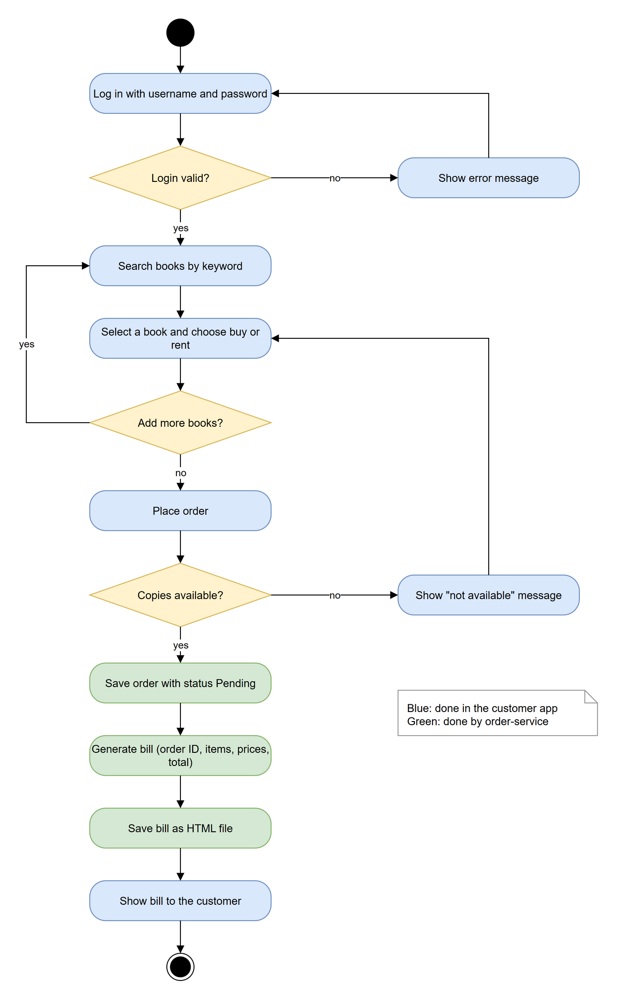

**Manager updates payment status**

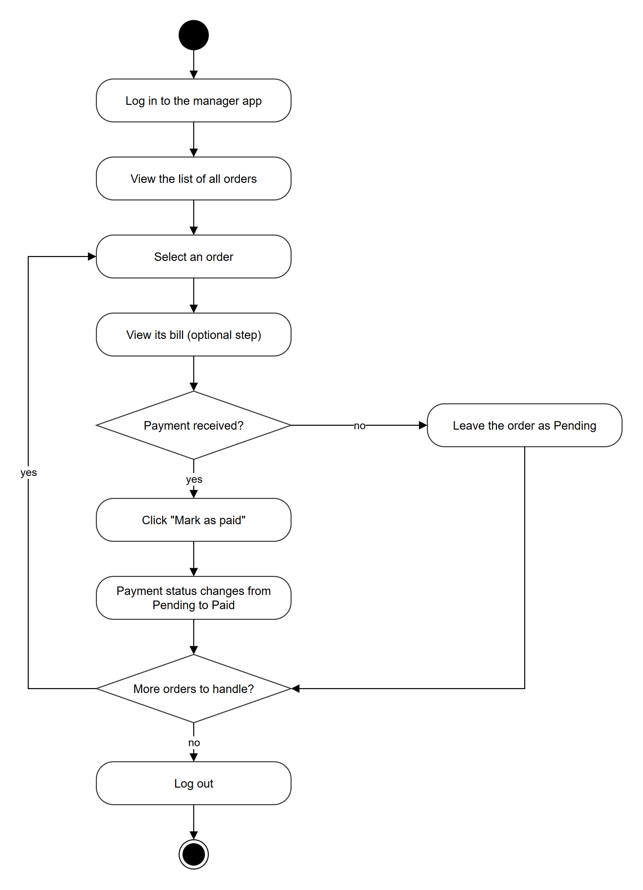

### 8. State machine diagram

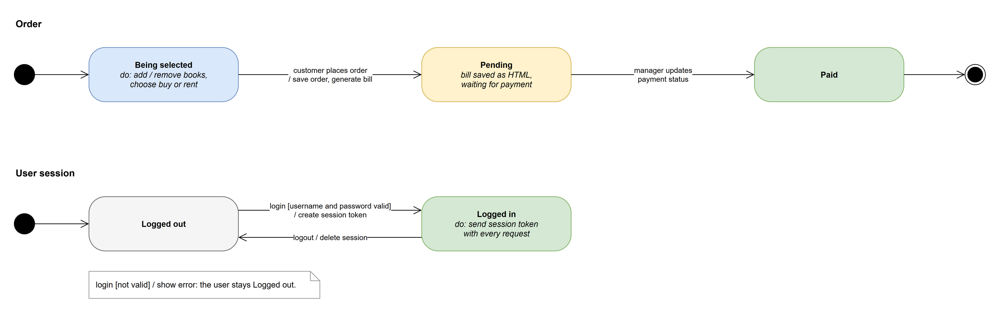

An order moves from being selected, to `PENDING` when it is placed, to `PAID` when the manager updates it. A session is created at login and deleted at logout.
