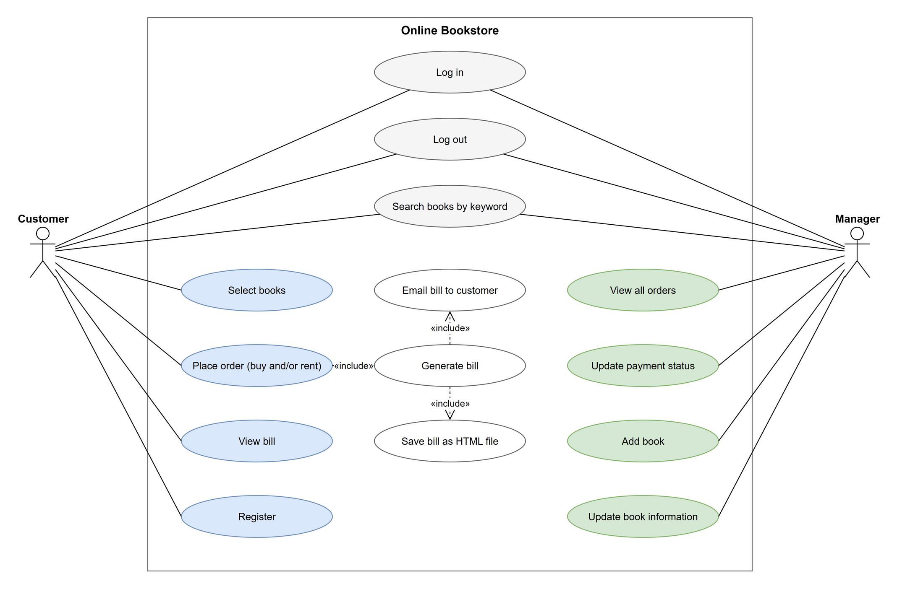

# Phase 2 — Use cases

> Status: **draft**. To be finalized in milestone M2.

## Use case diagram

Source: [diagrams/use-case.drawio](diagrams/use-case.drawio)

## Summary

| ID | Use case | Actor | Requirement |
|---|---|---|---|
| [UC1](#uc1--log-in) | Log in | Customer, Manager | FR1, FR11 |
| [UC2](#uc2--log-out) | Log out | Customer, Manager | FR2 |
| [UC3](#uc3--register) | Register | Customer | FR3 (extra credit) |
| [UC4](#uc4--search-books-by-keyword) | Search books by keyword | Customer, Manager | FR4, FR5 |
| [UC5](#uc5--select-books) | Select books | Customer | FR6 |
| [UC6](#uc6--place-order) | Place order (buy and/or rent) | Customer | FR7 |
| [UC7](#uc7--generate-bill) | Generate bill | System (part of UC6) | FR8 |
| [UC8](#uc8--save-bill-as-html-file) | Save bill as HTML file | System (part of UC7) | FR9 |
| [UC9](#uc9--email-bill-to-customer) | Email bill to customer | System (part of UC7) | FR10 (extra credit) |
| [UC10](#uc10--view-bill) | View bill | Customer | FR8 |
| [UC11](#uc11--view-all-orders) | View all orders | Manager | FR12 |
| [UC12](#uc12--update-payment-status) | Update payment status | Manager | FR13 |
| [UC13](#uc13--add-book) | Add book | Manager | FR14 |
| [UC14](#uc14--update-book-information) | Update book information | Manager | FR14 |

## Descriptions

### UC1 — Log in

| | |
|---|---|
| **Actor** | Customer or Manager |
| **Goal** | Prove who you are and start a session |
| **Requirements** | FR1, FR11, N3, N4 |
| **Before** | The user has an account. The app is open on the login screen. |
| **Main flow** | 1. The user enters a username and password and clicks "Log in". 2. The app sends them to user-service. 3. user-service finds the user and checks the password against its bcrypt hash. 4. user-service creates a session and returns a token and the user's role. 5. The app keeps the token and opens the main screen. |
| **Other flows** | **3a.** Username not found or password wrong: the app shows "Wrong username or password" and stays on the login screen. **5a.** In the manager app, the role is not Manager: the app shows "Access denied" and stays on the login screen. **2a.** The service cannot be reached: the app shows "Cannot connect to the server". |
| **After** | The user is logged in. Every later request carries the session token. |

### UC2 — Log out

| | |
|---|---|
| **Actor** | Customer or Manager |
| **Goal** | End the session |
| **Requirements** | FR2 |
| **Before** | The user is logged in. |
| **Main flow** | 1. The user clicks "Log out". 2. The app tells user-service to end the session. 3. user-service deletes the session. 4. The app forgets the token and shows the login screen. |
| **Other flows** | **2a.** The service cannot be reached: the app still forgets the token and shows the login screen. |
| **After** | The token no longer works. Any order being prepared but not placed is discarded. |

### UC3 — Register

| | |
|---|---|
| **Actor** | Customer |
| **Goal** | Create a new customer account |
| **Requirements** | FR3 (extra credit), N3 |
| **Before** | The customer app is open on the login screen. |
| **Main flow** | 1. The user clicks "Create an account". 2. The user enters a username, an email, and a password twice, and clicks "Create account". 3. The app checks that every field is filled in, the email looks valid, and the two passwords match. 4. The app sends the details to user-service. 5. user-service checks the username and email are not already used, hashes the password with bcrypt, and saves the account with the Customer role. 6. The app shows "Account created" and returns to the login screen. |
| **Other flows** | **3a.** A field is missing or invalid: the app shows which one and does not send anything. **5a.** The username or email is already used: the app shows "Username or email already in use". |
| **After** | A new customer account exists. The user is not logged in yet. |

### UC4 — Search books by keyword

| | |
|---|---|
| **Actor** | Customer or Manager |
| **Goal** | Find books by title or author |
| **Requirements** | FR4, FR5, N1, N2 |
| **Before** | The user is logged in. |
| **Main flow** | 1. The user types a keyword and clicks "Search". 2. The app sends the keyword to book-service in the background and shows "Searching…". 3. book-service finds every book whose title or author contains the keyword (upper or lower case does not matter). 4. The app shows the results as a list with title, author, price, and available copies. |
| **Other flows** | **3a.** Nothing matches: the app shows "No books found". **1a.** The keyword is empty: all books are listed. |
| **After** | The matching books are on screen. Nothing has changed in the system. |

### UC5 — Select books

| | |
|---|---|
| **Actor** | Customer |
| **Goal** | Choose the books to order |
| **Requirements** | FR6, FR7 |
| **Before** | The customer is logged in and has search results on screen. |
| **Main flow** | 1. The customer selects a book in the results. 2. The customer clicks "Add to order: Buy" or "Add to order: Rent". 3. The app adds the book to the order and updates the count on the "View order" button. 4. The customer repeats this for as many books as they want, searching again if needed. |
| **Other flows** | **2a.** The book has no copies available: the buttons are disabled. **3a.** The book is already in the order: the app does not add it twice. |
| **After** | The order being prepared contains the chosen books. Nothing is saved on the server yet. |

### UC6 — Place order

| | |
|---|---|
| **Actor** | Customer |
| **Goal** | Buy and/or rent the selected books in one transaction |
| **Requirements** | FR7, N2, N4, N5 |
| **Before** | The customer is logged in and has at least one book in the order. |
| **Main flow** | 1. The customer opens "Your order" and reviews the books, changing Buy/Rent or removing books if they want. 2. The customer clicks "Place order". 3. The app sends the order to order-service in the background. 4. order-service checks the session, gets each book's current price and copies from book-service, and calculates the charges: a bought book costs its price; a rented book costs 10% of its price and is due back in 7 days. 5. order-service saves the order with payment status Pending and reduces the available copies of each book by one. 6. order-service generates the bill (UC7). 7. The app shows the bill (UC10). |
| **Other flows** | **4a.** A book has no copies left: nothing is saved, and the app shows which book is not available. **4b.** The session is no longer valid: the app returns to the login screen. **3a.** The service cannot be reached: the app shows an error and keeps the order so the customer can try again. |
| **After** | The order exists with status Pending, the bill is saved, and the copies are reduced. |

### UC7 — Generate bill

| | |
|---|---|
| **Actor** | System (order-service), as part of UC6 |
| **Goal** | Produce a detailed bill for the order |
| **Requirements** | FR8 |
| **Before** | An order has just been saved. |
| **Main flow** | 1. order-service builds the bill with: the unique order ID, the date, the customer, every item with its type (buy or rent) and individual price, the rent due date for rented items, and the total amount due. 2. order-service saves the bill as an HTML file (UC8). 3. order-service emails the bill to the customer (UC9). |
| **Other flows** | None. |
| **After** | The bill exists and is returned to the customer app. |

### UC8 — Save bill as HTML file

| | |
|---|---|
| **Actor** | System (order-service), as part of UC7 |
| **Goal** | Keep the bill as a file the manager can print and post |
| **Requirements** | FR9 |
| **Before** | The bill has been built. |
| **Main flow** | 1. order-service writes the bill to `bills/bill-<orderId>.html`. 2. order-service records the file name on the order. |
| **Other flows** | **1a.** The file cannot be written: the order is not completed and the customer app shows an error. |
| **After** | The HTML file exists and can be opened in any browser and printed. |

### UC9 — Email bill to customer

| | |
|---|---|
| **Actor** | System (order-service), as part of UC7 |
| **Goal** | Send the bill to the customer automatically |
| **Requirements** | FR10 (extra credit) |
| **Before** | The bill has been saved. The customer account has an email address. |
| **Main flow** | 1. order-service sends an email to the customer's address with the bill as its content. |
| **Other flows** | **1a.** The email cannot be sent: the order is still completed (the bill file exists) and the failure is written to the service log. |
| **After** | The customer has the bill in their inbox. |

### UC10 — View bill

| | |
|---|---|
| **Actor** | Customer (their own bill); Manager (any bill) |
| **Goal** | See the bill of an order |
| **Requirements** | FR8, N5 |
| **Before** | The order exists. |
| **Main flow** | 1. Customer: the bill is shown right after the order is placed. Manager: selects an order and clicks "View bill". 2. The app shows the bill. |
| **Other flows** | **1a.** A customer asks for a bill that is not theirs: order-service refuses. |
| **After** | Nothing changes. |

### UC11 — View all orders

| | |
|---|---|
| **Actor** | Manager |
| **Goal** | See every purchase order in the system |
| **Requirements** | FR12, N5 |
| **Before** | The manager is logged in to the manager app. |
| **Main flow** | 1. The manager opens the Orders tab (or clicks "Refresh"). 2. The app asks order-service for all orders in the background. 3. The app lists them, newest first, with order ID, customer, date, total, and payment status. |
| **Other flows** | **2a.** There are no orders: the list is empty and says "No orders yet". **2b.** The token does not belong to a manager: order-service refuses. |
| **After** | Nothing changes. |

### UC12 — Update payment status

| | |
|---|---|
| **Actor** | Manager |
| **Goal** | Record that an order has been paid |
| **Requirements** | FR13, N5 |
| **Before** | The manager is logged in and the orders are listed. |
| **Main flow** | 1. The manager selects an order with status Pending. 2. The manager clicks "Mark as paid". 3. The app sends the change to order-service. 4. order-service sets the payment status to Paid. 5. The row in the list now shows Paid. |
| **Other flows** | **1a.** The selected order is already Paid: the button is disabled. **3a.** The token does not belong to a manager: order-service refuses. |
| **After** | The order's payment status is Paid. |

### UC13 — Add book

| | |
|---|---|
| **Actor** | Manager |
| **Goal** | Add a new book to the catalog |
| **Requirements** | FR14, N5 |
| **Before** | The manager is logged in and on the Books tab. |
| **Main flow** | 1. The manager clicks "Add book". 2. The manager enters the title, author, price, and number of available copies, and clicks "Save". 3. The app checks the fields and sends the book to book-service. 4. book-service saves the book. 5. The book appears in the list. |
| **Other flows** | **3a.** A field is empty, or the price or copies is not a valid number or is negative: the app shows which field is wrong. |
| **After** | The new book can be found by search and ordered. |

### UC14 — Update book information

| | |
|---|---|
| **Actor** | Manager |
| **Goal** | Change a book's details, such as the number of available copies |
| **Requirements** | FR14, N5 |
| **Before** | The manager is logged in and on the Books tab, with books listed. |
| **Main flow** | 1. The manager selects a book and clicks "Edit selected". 2. The dialog opens with the book's current details. 3. The manager changes what they want and clicks "Save". 4. The app checks the fields and sends the change to book-service. 5. book-service saves it, and the list shows the new values. |
| **Other flows** | **4a.** A field is invalid: the app shows which one. **3a.** The manager clicks "Cancel": nothing changes. |
| **After** | The book has the new details. Existing orders and bills keep the price they were made with. |
